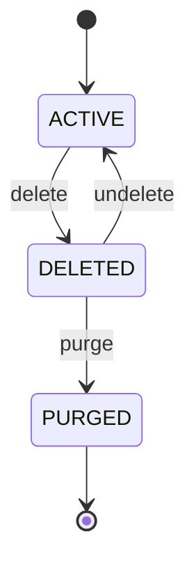

# Asset status

The life of a file in a shop's library (S31), decided by one pure function, `assetTransition(status, command)`
([code: packages/backend/libs/domains/asset-library/domain/asset-status.ts#assetTransition]). The answer is `apply` (a real move) or `refused`. The services
apply a move with a conditional update (`UPDATE … WHERE status = $from`), so a second command racing the first finds the status already changed. The unit
test `asset-status.spec.ts` writes the whole table out independently of the implementation; this page is checked against the code:
`python3 scripts/livespec/models.py check`.

<!-- diagram:start -->

<!-- diagram:end -->

```statemachine
initial: ACTIVE
terminal: PURGED
states: ACTIVE, DELETED, PURGED
events: delete, undelete, purge
refused: ACTIVE.undelete, ACTIVE.purge, DELETED.delete
ACTIVE --delete--> DELETED
DELETED --undelete--> ACTIVE
DELETED --purge--> PURGED
```

## Reading the table
- `delete` frees the path at once and stamps `deletedAt`; versions and chunks stay, so the file can come back. It is refused while the file is linked to a digital product or referenced by an entitlement.
- `undelete` is allowed for 30 days after `deletedAt` and only when no other live asset holds the path.
- `purge` runs from the retention job 30 days after `deletedAt`: versions go, chunk references are released exactly once, share links go. `PURGED` accepts nothing.
- Proof: [proof: S31 AS-38, S31 AS-39, S31 AS-40]
