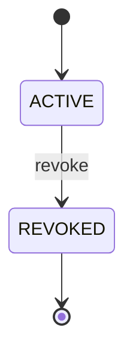

# Entitlement status

A buyer's right to download one digital product's file (S31), created by `order.paid` and ended by `order.refunded` or by the deletion of the shop. The right
is stored in `AssetEntitlement`; the move is one conditional update (`UPDATE … WHERE status = 'ACTIVE'`), so a repeated or racing revocation changes nothing and
publishes no second event ([code: packages/backend/libs/domains/asset-library/domain/ports.ts#EntitlementRecord]). `REVOKED` is terminal: the order's refund is recorded
too, so a late or replayed paid event grants nothing again.

<!-- diagram:start -->

<!-- diagram:end -->

```statemachine
initial: ACTIVE
terminal: REVOKED
states: ACTIVE, REVOKED
events: revoke
ACTIVE --revoke--> REVOKED
```

## Reading the table
- `revoke` carries a reason: `refunded` (a full refund of the order) or `shop_deleted`.
- A revoked entitlement no longer lists in "My purchases", answers `404` to a download request and makes every outstanding download URL answer `410`.
- Proof: [proof: S31 AS-64, S31 AS-65, S31 AS-71]
