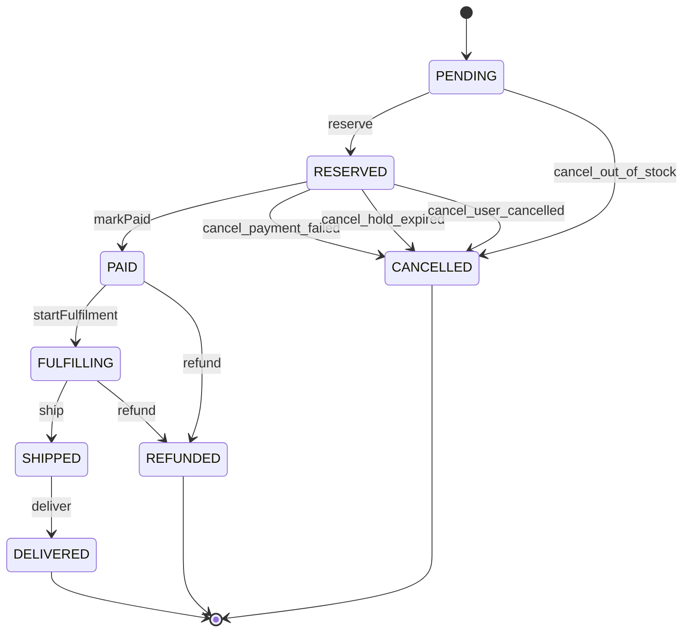

# Order status

The lifecycle of an order (S10), decided by one pure function, `decide(status, command)`
([code: packages/backend/libs/domains/orders/domain/order-state.ts#decide]). The answer is one of `apply` (a real move), `already_applied` (a repeat of a
move that already happened, a harmless no-op) or `invalid`. The unit test `order-state.spec.ts` writes the whole table out independently of the implementation;
this page is checked against the code: `python3 scripts/livespec/models.py check`.

<!-- diagram:start -->

<!-- diagram:end -->

```statemachine
initial: PENDING
terminal: DELIVERED, CANCELLED, REFUNDED
states: PENDING, RESERVED, PAID, FULFILLING, SHIPPED, DELIVERED, CANCELLED, REFUNDED
events: reserve, markPaid, cancel_out_of_stock, cancel_payment_failed, cancel_hold_expired, cancel_user_cancelled, startFulfilment, ship, deliver, refund
idempotent: PAID.markPaid, FULFILLING.markPaid, SHIPPED.markPaid
refused: PENDING.markPaid, PENDING.cancel_payment_failed, PENDING.cancel_hold_expired, PENDING.cancel_user_cancelled, PENDING.startFulfilment, PENDING.ship, PENDING.deliver, PENDING.refund, RESERVED.reserve, RESERVED.cancel_out_of_stock, RESERVED.startFulfilment, RESERVED.ship, RESERVED.deliver, RESERVED.refund, PAID.reserve, PAID.cancel_out_of_stock, PAID.cancel_payment_failed, PAID.cancel_hold_expired, PAID.cancel_user_cancelled, PAID.ship, PAID.deliver, FULFILLING.reserve, FULFILLING.cancel_out_of_stock, FULFILLING.cancel_payment_failed, FULFILLING.cancel_hold_expired, FULFILLING.cancel_user_cancelled, FULFILLING.startFulfilment, FULFILLING.deliver, SHIPPED.reserve, SHIPPED.cancel_out_of_stock, SHIPPED.cancel_payment_failed, SHIPPED.cancel_hold_expired, SHIPPED.cancel_user_cancelled, SHIPPED.startFulfilment, SHIPPED.ship, SHIPPED.refund
PENDING --reserve--> RESERVED
RESERVED --markPaid--> PAID
PENDING --cancel_out_of_stock--> CANCELLED
RESERVED --cancel_payment_failed--> CANCELLED
RESERVED --cancel_hold_expired--> CANCELLED
RESERVED --cancel_user_cancelled--> CANCELLED
PAID --startFulfilment--> FULFILLING
FULFILLING --ship--> SHIPPED
SHIPPED --deliver--> DELIVERED
PAID --refund--> REFUNDED
FULFILLING --refund--> REFUNDED
```

## Reading the table
- The forward path is `PENDING`, `RESERVED`, `PAID`, `FULFILLING`, `SHIPPED`, `DELIVERED`; it is the only forward path.
- A reservation holds stock until `reservedUntil`; `cancel_hold_expired` releases it. `cancel_out_of_stock` is the only cancellation allowed from `PENDING`.
- `markPaid` repeated after the order is paid (or further along) is a no-op, so a duplicate payment event cannot move an order backwards.
- `refund` is allowed from `PAID` and `FULFILLING`, not after shipping.
- `DELIVERED`, `CANCELLED` and `REFUNDED` accept no applying move (also in the terminal states, repeats of `markPaid`, `cancel_*` and `refund` are no-ops).
- Proof: [proof: S10 AS-54] (`order-state.spec.ts` checks every command against every status).
