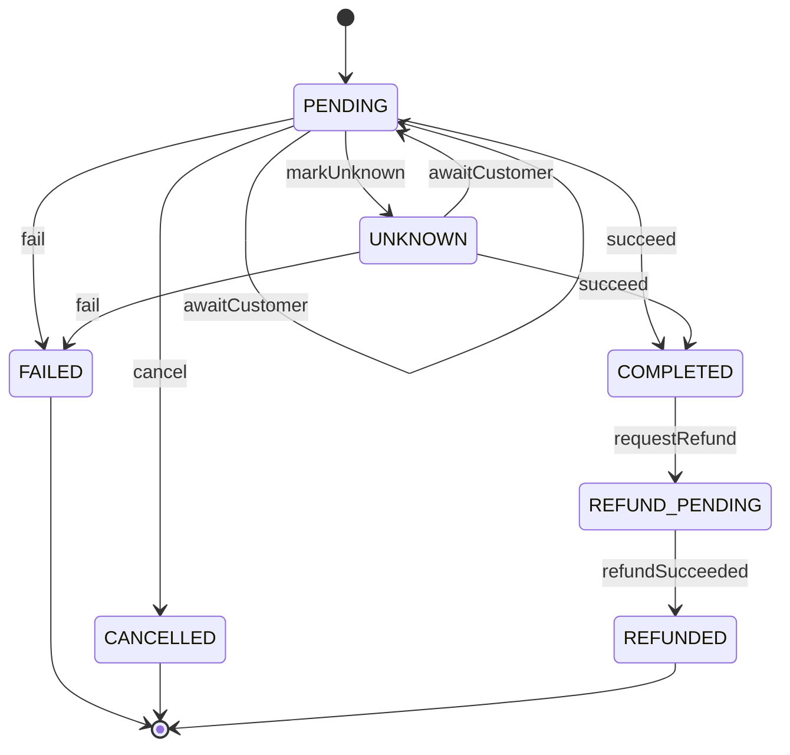

# Payment status

The lifecycle of a payment (S13). Every status change goes through one pure function, `decide(from, command)`
([code: packages/backend/libs/domains/payments/domain/payment-status.ts#decide]); a pair that is not in the table throws `InvalidPaymentTransition`.
This page is checked against the code: `python3 scripts/livespec/models.py check`.

<!-- diagram:start -->

<!-- diagram:end -->

```statemachine
initial: PENDING
terminal: FAILED, CANCELLED, REFUNDED
states: PENDING, UNKNOWN, COMPLETED, FAILED, CANCELLED, REFUND_PENDING, REFUNDED
events: succeed, fail, markUnknown, awaitCustomer, cancel, requestRefund, refundSucceeded
refused: PENDING.requestRefund, PENDING.refundSucceeded, UNKNOWN.markUnknown, UNKNOWN.cancel, UNKNOWN.requestRefund, UNKNOWN.refundSucceeded, COMPLETED.succeed, COMPLETED.fail, COMPLETED.markUnknown, COMPLETED.awaitCustomer, COMPLETED.cancel, COMPLETED.refundSucceeded, REFUND_PENDING.succeed, REFUND_PENDING.fail, REFUND_PENDING.markUnknown, REFUND_PENDING.awaitCustomer, REFUND_PENDING.cancel, REFUND_PENDING.requestRefund
PENDING --succeed--> COMPLETED
PENDING --fail--> FAILED
PENDING --markUnknown--> UNKNOWN
PENDING --awaitCustomer--> PENDING
PENDING --cancel--> CANCELLED
UNKNOWN --succeed--> COMPLETED
UNKNOWN --fail--> FAILED
UNKNOWN --awaitCustomer--> PENDING
COMPLETED --requestRefund--> REFUND_PENDING
REFUND_PENDING --refundSucceeded--> REFUNDED
```

## Reading the table
- `awaitCustomer` on `PENDING` is a flag-only move (the provider waits for the customer, for example 3-D Secure); the status stays `PENDING` and the
  version does not change. From `UNKNOWN` it returns the payment to `PENDING`.
- `cancel` from `PENDING` is refused once a charge attempt was recorded, unless the provider is waiting for the customer (nothing was charged then).
- `UNKNOWN` means the provider's answer was lost (timeout, crash, invalid response); it is resolved later to `COMPLETED` or `FAILED`.
- `FAILED`, `CANCELLED` and `REFUNDED` are final. A late result for a final payment is refused, never applied.
- Proof: [proof: S13 AS-40, S13 AS-41, S13 AS-42] (the guarded-transition and race tests, `payment-transitions.e2e-spec.ts`).
