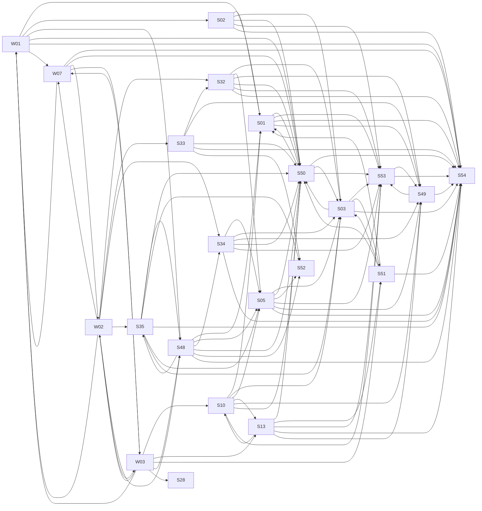

# System overview

_Generated by `scripts/livespec/generate.py --system`; never edit by hand. The layers and the rules for pages are in [README.md](README.md)._

21 capabilities, 16 shared concepts, 3 models. A page is `draft` until a human has read and signed it.

## Capabilities
- [S01](capabilities/S01-auth-sessions.md) Registration, password login, sessions, refresh-token rotation, JWKS, service-to-service t (41 items; draft)
- [S02](capabilities/S02-mfa-oidc.md) TOTP MFA with recovery codes, Google OIDC login (PKCE), account linking (44 items; draft)
- [S03](capabilities/S03-shops-rbac.md) Shops as tenants: memberships, roles and permissions, invites, per-shop SSO, cells, offboa (38 items; draft)
- [S05](capabilities/S05-products.md) Product CRUD, pricing, stock fields, product cache and invalidation, product views (38 items; draft)
- [S10](capabilities/S10-cart-checkout.md) Cart (guest + merge), idempotent checkout, stock reservation, multi-shop split, order stat (54 items; draft)
- [S13](capabilities/S13-payment-intents.md) Payment intents, idempotency, unknown outcomes, PSP circuit breaker, outbox, saga with ord (45 items; draft)
- [S32](capabilities/S32-product-search.md) Product search: index sync with external versioning, zero-downtime reindex, relevance boos (41 items; draft)
- [S33](capabilities/S33-autocomplete.md) Search autocomplete: query-log top-K trie, catalog completions, per-source budgets, typo f (45 items; draft)
- [S34](capabilities/S34-recommendations.md) "Bought together" recommendations: co-occurrence graph, normalisation, 2-hop cold start (41 items; draft)
- [S35](capabilities/S35-trending.md) Trending products: windowed approximate top-K per category (40 items; draft)
- [S48](capabilities/S48-bff.md) BFF composition: product-page aggregate with budgets and partial errors, GraphQL with Data (40 items; draft)
- [S49](capabilities/S49-job-scheduler.md) Distributed job scheduler: SKIP LOCKED leases, retries, cron leader, fairness, tz-aware cr (40 items; draft)
- [S50](capabilities/S50-rate-limiter.md) Rate limiting: token bucket, sliding window, concurrency limits, fail modes, headers (40 items; draft)
- [S51](capabilities/S51-realtime-push.md) Realtime push hub: topic SSE, Last-Event-ID replay, per-topic policies, ref-counted fan-ou (48 items; draft)
- [S52](capabilities/S52-cache-toolkit.md) Cache toolkit: L1/L2, single-flight, XFetch, SWR, negative cache, write-behind counters, E (40 items; draft)
- [S53](capabilities/S53-events-projections.md) Domain events, outbox/CDC → Kafka, idempotent versioned projections, replay, read-your-wri (40 items; draft)
- [S54](capabilities/S54-platform-toolkit.md) Platform toolkit: problem+json errors, request context and transactions, health probes, gr (40 items; draft)
- [W01](capabilities/W01-auth-account.md) Sign up, log in, forgot password, MFA step-up, session cookie via BFF, CSRF, logout, accou (41 items; draft)
- [W02](capabilities/W02-storefront-discovery.md) Home, search (autocomplete, filters, facets, sort, URL state), trending and recommendation (40 items; draft)
- [W03](capabilities/W03-cart-checkout-orders.md) Cart (guest and merged on login), checkout with idempotent submit and async payment status (40 items; draft)
- [W07](capabilities/W07-app-shell.md) App shell and cross-cutting UI: navbar, footer, legal pages, developer docs, error/not-fou (35 items; draft)

## Dependencies between capabilities

## Shared concepts
- [Access tokens and sessions](concepts/access-token-session.md): defined by {{cap:S01}}; used by 7 capabilities
- [The BFF and page aggregates](concepts/bff-aggregate.md): defined by {{cap:S48}}; used by 5 capabilities
- [Layered cache and single-flight](concepts/cache-layers.md): defined by {{cap:S52}}; used by 8 capabilities
- [Idempotency keys](concepts/idempotency-key.md): defined by {{cap:S54}}; used by 9 capabilities
- [Scheduled jobs and leases](concepts/job-scheduler-lease.md): defined by {{cap:S49}}; used by 9 capabilities
- [Orders, reservations and stock](concepts/order-reservation.md): defined by {{cap:S10}}; used by 4 capabilities
- [The outbox: events and tasks](concepts/outbox-task-queue.md): defined by {{cap:S53}}; used by 8 capabilities
- [Payments and their lifecycle](concepts/payment-lifecycle.md): defined by {{cap:S13}}; used by 3 capabilities
- [Errors as problem+json](concepts/problem-json-errors.md): defined by {{cap:S54}}; used by 20 capabilities
- [Projections, versions and replay](concepts/projection-and-replay.md): defined by {{cap:S53}}; used by 5 capabilities
- [Rate-limit policies](concepts/rate-limit-policy.md): defined by {{cap:S50}}; used by 18 capabilities
- [Realtime topics and the stream](concepts/realtime-topic-stream.md): defined by {{cap:S51}}; used by 4 capabilities
- [Request context and tracing](concepts/request-context.md): defined by {{cap:S54}}; used by 6 capabilities
- [The product search index](concepts/search-index.md): defined by {{cap:S32}}; used by 3 capabilities
- [Shops as tenants and roles](concepts/tenant-shop-rbac.md): defined by {{cap:S03}}; used by 6 capabilities
- [Transactions and the transaction runner](concepts/transaction-runner.md): defined by {{cap:S54}}; used by 9 capabilities

## Models
- [Delivery of a payment's charge request](models/charge-delivery.md) (quint)
- [Order status](models/order-status.md) (state machine)
- [Payment status](models/payment-status.md) (state machine)

## Verification

- `python3 scripts/livespec/check.py`: links, proofs, code references, routes, concepts, models, sign-off drift
- `python3 scripts/livespec/models.py check`: state machines against the code
- `python3 scripts/livespec/run_models.py`: Quint models
- `python3 scripts/livespec/sign.py status`: who reviewed what
