# System overview

_Generated by `scripts/livespec/generate.py --system`; never edit by hand. The layers and the rules for pages are in [README.md](README.md)._

65 capabilities, 16 shared concepts, 5 models. A page is `draft` until a human has read and signed it.

## Capabilities
- [J01](capabilities/J01-buy-to-payout.md) Buyer pays for a multi-shop order; order paid → ledger journals → settlement → seller payo (33 items; draft)
- [J02](capabilities/J02-seller-to-first-sale.md) New seller registers, creates a shop, passes onboarding/KYC, subscribes to a plan, lists a (39 items; draft)
- [J03](capabilities/J03-launch-day.md) Launch day: waiting room and seat booking, flash-sale purchase without overselling, live s (39 items; draft)
- [S01](capabilities/S01-auth-sessions.md) Registration, password login, sessions, refresh-token rotation, JWKS, service-to-service t (74 items; draft)
- [S02](capabilities/S02-mfa-oidc.md) TOTP MFA with recovery codes, Google OIDC login (PKCE), account linking (61 items; draft)
- [S03](capabilities/S03-shops-rbac.md) Shops as tenants: memberships, roles and permissions, invites, per-shop SSO, cells, offboa (56 items; draft)
- [S04](capabilities/S04-kyc-onboarding.md) Staged onboarding questionnaire, KYC document intake, LLM extraction, human review, shop v (53 items; draft)
- [S05](capabilities/S05-products.md) Product CRUD, pricing, stock fields, product cache and invalidation, product views (49 items; draft)
- [S06](capabilities/S06-collab-editor.md) Collaborative listing drafts (CRDT rooms, permissions per update, version history, publish (32 items; draft)
- [S07](capabilities/S07-bulk-import.md) Bulk catalog import: multipart upload, AV scan, streamed parse, checkpoints, error report (26 items; draft)
- [S08](capabilities/S08-integrations.md) Shopify/WooCommerce catalog and stock sync (incremental, bidirectional stock, reconciliati (49 items; draft)
- [S09](capabilities/S09-offline-sync.md) Offline-first inventory sync for store devices (op idempotency, deltas, per-field LWW, con (19 items; draft)
- [S10](capabilities/S10-cart-checkout.md) Cart (guest + merge), idempotent checkout, stock reservation, multi-shop split, order stat (68 items; draft)
- [S11](capabilities/S11-flash-sales.md) Flash sales: bucketed Redis stock, admission, never oversell, async reconciliation to Post (24 items; draft)
- [S12](capabilities/S12-order-export.md) Order export (streamed CSV to object storage, progress) including moving its routes and qu (18 items; draft)
- [S13](capabilities/S13-payment-intents.md) Payment intents, idempotency, unknown outcomes, PSP circuit breaker, outbox, saga with ord (52 items; draft)
- [S14](capabilities/S14-ledger-reconciliation.md) Double-entry ledger, balanced journals, hot-account sharding, balance read model, daily PS (63 items; draft)
- [S15](capabilities/S15-payouts.md) Seller payouts: weekly run, reserves, provider transfer with idempotency, payout states (35 items; draft)
- [S16](capabilities/S16-seller-statements.md) Bitemporal commission rates, monthly statements, period close, adjustments, as-of reports, (30 items; draft)
- [S17](capabilities/S17-subscriptions.md) Plans, versioned prices, subscription state machine, billing run, proration, dunning (38 items; draft)
- [S18](capabilities/S18-usage-entitlements.md) Usage metering (late events, adjustments) and entitlement checks used by other domains (25 items; draft)
- [S19](capabilities/S19-pickup-near-me.md) Pickup points, local stock, "available near me" search, map clustering (43 items; draft)
- [S20](capabilities/S20-courier-delivery.md) Same-day courier dispatch: location ingest, offers with timeout, delivery state machine, l (39 items; draft)
- [S21](capabilities/S21-limited-drops.md) English auctions: proxy bids, anti-sniping, reserve, exactly-once close, second chance, sh (33 items; draft)
- [S22](capabilities/S22-launch-event-booking.md) Launch-event booking: waiting room, admission tokens, seat holds, booking confirm, seat ma (45 items; draft)
- [S23](capabilities/S23-live-stream.md) Live launch stream comments and reactions: sampling, batching, moderation, pinned commerce (41 items; draft)
- [S24](capabilities/S24-product-chat.md) Product chat: channels, idempotent send, per-channel sequence, sync on reconnect, unread,  (37 items; draft)
- [S25](capabilities/S25-discussions.md) Product discussion boards: posts, nested comments, votes, hot/top/new/best ranking, abuse  (47 items; draft)
- [S26](capabilities/S26-follow-feed.md) Follow graph and home feed (hybrid fan-out, celebrity merge, rebuild on return) (35 items; draft)
- [S27](capabilities/S27-brand-stories.md) Brand stories CMS: versioned multi-locale stories, scheduled publish, preview, cache tags, (36 items; draft)
- [S28](capabilities/S28-notifications.md) Notification routing: preferences, quiet hours, caps, per-channel queues, provider failove (72 items; draft)
- [S29](capabilities/S29-photos.md) Product and review photos: presigned upload, processing pipeline, EXIF strip, variants, du (47 items; draft)
- [S30](capabilities/S30-video.md) Product video and VOD: resumable upload, transcoding DAG, HLS ladder, signed delivery (32 items; draft)
- [S31](capabilities/S31-assets-digital-delivery.md) Shop asset library (chunked dedupe, delta sync, conflicts, share links) and digital produc (53 items; draft)
- [S32](capabilities/S32-product-search.md) Product search: index sync with external versioning, zero-downtime reindex, relevance boos (79 items; draft)
- [S33](capabilities/S33-autocomplete.md) Search autocomplete: query-log top-K trie, catalog completions, per-source budgets, typo f (45 items; draft)
- [S34](capabilities/S34-recommendations.md) "Bought together" recommendations: co-occurrence graph, normalisation, 2-hop cold start (41 items; draft)
- [S35](capabilities/S35-trending.md) Trending products: windowed approximate top-K per category (40 items; draft)
- [S36](capabilities/S36-sponsored-listings.md) Sponsored listings: signed click tokens, exact dedupe, click-spam filter, reconciled billi (73 items; draft)
- [S37](capabilities/S37-share-links.md) Share and affiliate short links: code generation, custom aliases, redirects, click attribu (44 items; draft)
- [S38](capabilities/S38-feature-flags.md) Feature flags and remote config: targeting, % rollout, local evaluation, kill switches, au (44 items; draft)
- [S39](capabilities/S39-analytics-ab.md) Analytics ingestion and A/B testing: event schema, dedupe, assignment, exposure, SRM, resu (46 items; draft)
- [S40](capabilities/S40-leaderboards-dashboard.md) Seller leaderboards (ties, my rank, period snapshots), live sales dashboard, seller stats (37 items; draft)
- [S41](capabilities/S41-competitor-monitor.md) Competitor price monitor: polite crawling, robots, SSRF-safe fetch, price extraction, aler (35 items; draft)
- [S42](capabilities/S42-public-api.md) Seller public API: API keys, scopes, sandbox, date-pinned versions, deprecation headers, b (49 items; draft)
- [S43](capabilities/S43-webhooks.md) Webhook delivery to shops: subscriptions, signing with dual secrets, per-endpoint ordering (37 items; draft)
- [S44](capabilities/S44-storefront-widget.md) Embeddable storefront widget: site keys bound to origins, frame-ancestors, identity hand-o (44 items; draft)
- [S45](capabilities/S45-discount-functions.md) Seller discount functions: submission, sandboxed judge with test cases, versions, fail-saf (27 items; draft)
- [S46](capabilities/S46-shopping-assistant.md) Streamed shopping assistant: read-only tools, resumable streams, quotas, fallback model, m (63 items; draft)
- [S47](capabilities/S47-rag-help-center.md) "Ask this product" and shop help center: ingestion, hybrid retrieval with in-query permiss (48 items; draft)
- [S48](capabilities/S48-bff.md) BFF composition: product-page aggregate with budgets and partial errors, GraphQL with Data (40 items; draft)
- [S49](capabilities/S49-job-scheduler.md) Distributed job scheduler: SKIP LOCKED leases, retries, cron leader, fairness, tz-aware cr (40 items; draft)
- [S50](capabilities/S50-rate-limiter.md) Rate limiting: token bucket, sliding window, concurrency limits, fail modes, headers (41 items; draft)
- [S51](capabilities/S51-realtime-push.md) Realtime push hub: topic SSE, Last-Event-ID replay, per-topic policies, ref-counted fan-ou (54 items; draft)
- [S52](capabilities/S52-cache-toolkit.md) Cache toolkit: L1/L2, single-flight, XFetch, SWR, negative cache, write-behind counters, E (40 items; draft)
- [S53](capabilities/S53-events-projections.md) Domain events, outbox/CDC → Kafka, idempotent versioned projections, replay, read-your-wri (44 items; draft)
- [S54](capabilities/S54-platform-toolkit.md) Platform toolkit: problem+json errors, request context and transactions, health probes, gr (43 items; draft)
- [S55](capabilities/S55-serverless-workers.md) Lambda workers: partial batch failures, idempotency records, FIFO groups, local runner (29 items; draft)
- [W01](capabilities/W01-auth-account.md) Sign up, log in, forgot password, MFA step-up, session cookie via BFF, CSRF, logout, accou (64 items; draft)
- [W02](capabilities/W02-storefront-discovery.md) Home, search (autocomplete, filters, facets, sort, URL state), trending and recommendation (57 items; draft)
- [W03](capabilities/W03-cart-checkout-orders.md) Cart (guest and merged on login), checkout with idempotent submit and async payment status (52 items; draft)
- [W04](capabilities/W04-seller-dashboard.md) Seller dashboard: shop overview, live sales numbers, inventory management, developer setti (71 items; draft)
- [W05](capabilities/W05-chat-assistant.md) Product chat (realtime, unread, receipts, reconnect) and the streamed shopping assistant s (27 items; draft)
- [W06](capabilities/W06-admin-flags.md) Admin feature-flag console: list, edit targeting and rollout, kill switch, audit trail (29 items; draft)
- [W07](capabilities/W07-app-shell.md) App shell and cross-cutting UI: navbar, footer, legal pages, developer docs, error/not-fou (52 items; draft)

## Dependencies between capabilities

```mermaid
graph LR
    J01 --> S10
    J01 --> S13
    J01 --> S14
    J01 --> S15
    J01 --> S16
    J01 --> S28
    J01 --> S49
    J01 --> S53
    J02 --> S01
    J02 --> S03
    J02 --> S04
    J02 --> S05
    J02 --> S10
    J02 --> S13
    J02 --> S17
    J02 --> S32
    J02 --> S40
    J02 --> S43
    J02 --> S53
    J02 --> J01
    J03 --> S03
    J03 --> S10
    J03 --> S11
    J03 --> S13
    J03 --> S21
    J03 --> S22
    J03 --> S23
    J03 --> S28
    J03 --> S49
    J03 --> S51
    J03 --> S53
    J03 --> J01
    S01 --> S50
    S01 --> S53
    S01 --> S54
    S01 --> S49
    S02 --> S01
    S02 --> S03
    S02 --> S50
    S02 --> S53
    S02 --> S54
    S03 --> S53
    S03 --> S50
    S03 --> S51
    S03 --> S54
    S04 --> S03
    S04 --> S53
    S04 --> S46
    S04 --> S54
    S04 --> S50
    S04 --> S01
    S05 --> S03
    S05 --> S50
    S05 --> S52
    S05 --> S53
    S05 --> S49
    S05 --> S54
    S06 --> S01
    S06 --> S03
    S06 --> S05
    S06 --> S49
    S06 --> S50
    S06 --> S53
    S06 --> S54
    S07 --> S01
    S07 --> S03
    S07 --> S05
    S07 --> S12
    S07 --> S29
    S07 --> S49
    S07 --> S50
    S07 --> S51
    S07 --> S53
    S07 --> S54
    S08 --> S01
    S08 --> S03
    S08 --> S05
    S08 --> S49
    S08 --> S50
    S08 --> S53
    S09 --> S01
    S09 --> S03
    S09 --> S05
    S09 --> S49
    S09 --> S50
    S09 --> S53
    S10 --> S01
    S10 --> S03
    S10 --> S05
    S10 --> S13
    S10 --> S49
    S10 --> S50
    S10 --> S53
    S11 --> S03
    S11 --> S05
    S11 --> S10
    S11 --> S49
    S11 --> S50
    S11 --> S52
    S11 --> S53
    S12 --> S03
    S12 --> S05
    S12 --> S10
    S12 --> S49
    S12 --> S50
    S12 --> S51
    S12 --> S53
    S13 --> S10
    S13 --> S50
    S13 --> S51
    S13 --> S53
    S13 --> S54
    S13 --> S49
    S14 --> S10
    S14 --> S13
    S14 --> S49
    S14 --> S50
    S14 --> S53
    S14 --> S54
    S15 --> S01
    S15 --> S03
    S15 --> S13
    S15 --> S14
    S15 --> S28
    S15 --> S43
    S15 --> S49
    S15 --> S50
    S15 --> S53
    S15 --> S54
    S16 --> S01
    S16 --> S03
    S16 --> S05
    S16 --> S10
    S16 --> S14
    S16 --> S15
    S16 --> S49
    S16 --> S50
    S16 --> S53
    S16 --> S54
    S17 --> S01
    S17 --> S03
    S17 --> S13
    S17 --> S18
    S17 --> S28
    S17 --> S49
    S17 --> S50
    S17 --> S53
    S17 --> S54
    S18 --> S01
    S18 --> S03
    S18 --> S17
    S18 --> S49
    S18 --> S50
    S18 --> S52
    S18 --> S53
    S18 --> S54
    S19 --> S01
    S19 --> S03
    S19 --> S05
    S19 --> S50
    S19 --> S53
    S19 --> S54
    S20 --> S01
    S20 --> S03
    S20 --> S10
    S20 --> S49
    S20 --> S50
    S20 --> S51
    S20 --> S53
    S20 --> S54
    S21 --> S01
    S21 --> S03
    S21 --> S05
    S21 --> S10
    S21 --> S18
    S21 --> S28
    S21 --> S49
    S21 --> S50
    S21 --> S51
    S21 --> S52
    S21 --> S53
    S21 --> S54
    S22 --> S01
    S22 --> S03
    S22 --> S49
    S22 --> S50
    S22 --> S51
    S22 --> S52
    S22 --> S53
    S22 --> S54
    S23 --> S01
    S23 --> S03
    S23 --> S05
    S23 --> S22
    S23 --> S49
    S23 --> S50
    S23 --> S51
    S23 --> S52
    S23 --> S53
    S23 --> S54
    S24 --> S01
    S24 --> S03
    S24 --> S05
    S24 --> S28
    S24 --> S48
    S24 --> S49
    S24 --> S50
    S24 --> S51
    S24 --> S52
    S24 --> S53
    S24 --> S54
    S25 --> S01
    S25 --> S05
    S25 --> S28
    S25 --> S50
    S25 --> S53
    S25 --> S54
    S26 --> S01
    S26 --> S03
    S26 --> S05
    S26 --> S25
    S26 --> S28
    S26 --> S50
    S27 --> S01
    S27 --> S03
    S27 --> S05
    S27 --> S49
    S27 --> S50
    S27 --> S52
    S27 --> S53
    S27 --> S54
    S28 --> S01
    S28 --> S03
    S28 --> S10
    S28 --> S13
    S28 --> S49
    S28 --> S50
    S28 --> S51
    S28 --> S52
    S28 --> S53
    S28 --> S54
    S29 --> S01
    S29 --> S03
    S29 --> S05
    S29 --> S49
    S29 --> S50
    S29 --> S53
    S29 --> S54
    S30 --> S01
    S30 --> S03
    S30 --> S05
    S30 --> S29
    S30 --> S49
    S30 --> S50
    S30 --> S53
    S30 --> S54
    S31 --> S01
    S31 --> S03
    S31 --> S05
    S31 --> S10
    S31 --> S49
    S31 --> S50
    S31 --> S51
    S31 --> S53
    S31 --> S54
    S32 --> S03
    S32 --> S05
    S32 --> S49
    S32 --> S50
    S32 --> S53
    S32 --> S54
    S33 --> S32
    S33 --> S49
    S33 --> S50
    S33 --> S54
    S33 --> S52
    S34 --> S05
    S34 --> S03
    S34 --> S49
    S34 --> S50
    S34 --> S53
    S34 --> S54
    S35 --> S48
    S35 --> S50
    S35 --> S52
    S35 --> S54
    S35 --> S05
    S35 --> S03
    S36 --> S01
    S36 --> S03
    S36 --> S05
    S36 --> S14
    S36 --> S49
    S36 --> S50
    S36 --> S53
    S36 --> S54
    S37 --> S01
    S37 --> S49
    S37 --> S50
    S37 --> S52
    S37 --> S53
    S37 --> S54
    S38 --> S01
    S38 --> S03
    S38 --> S49
    S38 --> S50
    S38 --> S51
    S38 --> S53
    S38 --> S54
    S39 --> S01
    S39 --> S10
    S39 --> S38
    S39 --> S50
    S39 --> S52
    S39 --> S53
    S39 --> S54
    S40 --> S01
    S40 --> S03
    S40 --> S05
    S40 --> S10
    S40 --> S49
    S40 --> S50
    S40 --> S51
    S40 --> S53
    S40 --> S54
    S41 --> S01
    S41 --> S03
    S41 --> S05
    S41 --> S18
    S41 --> S28
    S41 --> S49
    S41 --> S50
    S41 --> S53
    S41 --> S54
    S42 --> S54
    S42 --> S01
    S42 --> S03
    S42 --> S05
    S42 --> S10
    S42 --> S49
    S42 --> S50
    S42 --> S53
    S43 --> S54
    S43 --> S01
    S43 --> S03
    S43 --> S05
    S43 --> S10
    S43 --> S42
    S43 --> S49
    S43 --> S50
    S43 --> S52
    S43 --> S53
    S44 --> S54
    S44 --> S01
    S44 --> S03
    S44 --> S05
    S44 --> S50
    S44 --> S52
    S44 --> S53
    S45 --> S01
    S45 --> S03
    S45 --> S10
    S45 --> S18
    S45 --> S49
    S45 --> S50
    S45 --> S53
    S45 --> S54
    S46 --> S01
    S46 --> S05
    S46 --> S19
    S46 --> S32
    S46 --> S50
    S46 --> S53
    S46 --> S54
    S47 --> S01
    S47 --> S03
    S47 --> S05
    S47 --> S49
    S47 --> S50
    S47 --> S53
    S47 --> S54
    S48 --> S01
    S48 --> S05
    S48 --> S34
    S48 --> S35
    S48 --> S50
    S48 --> S52
    S48 --> S54
    S49 --> S53
    S49 --> S54
    S50 --> S54
    S50 --> S01
    S50 --> S03
    S50 --> S53
    S51 --> S01
    S51 --> S03
    S51 --> S50
    S51 --> S54
    S53 --> S49
    S53 --> S54
    S55 --> S53
    S55 --> S54
    W01 --> S01
    W01 --> S02
    W01 --> S48
    W01 --> S50
    W01 --> S54
    W01 --> W07
    W02 --> S32
    W02 --> S33
    W02 --> S34
    W02 --> S35
    W02 --> S48
    W02 --> W01
    W02 --> W03
    W02 --> W07
    W03 --> S10
    W03 --> S13
    W03 --> S51
    W03 --> S48
    W03 --> S28
    W03 --> W01
    W03 --> W02
    W03 --> W07
    W04 --> S03
    W04 --> S05
    W04 --> S40
    W04 --> S42
    W04 --> S43
    W04 --> S48
    W04 --> S51
    W04 --> W01
    W04 --> W02
    W04 --> W03
    W04 --> W07
    W05 --> S24
    W05 --> S46
    W05 --> S51
    W05 --> W01
    W05 --> W02
    W05 --> W07
    W06 --> S38
    W06 --> S48
    W06 --> W01
    W06 --> W07
    W07 --> S54
    W07 --> S50
    W07 --> W01
    W07 --> W02
    W07 --> W03
```

## Shared concepts
- [Access tokens and sessions](concepts/access-token-session.md): defined by {{cap:S01}}; used by 10 capabilities
- [The BFF and page aggregates](concepts/bff-aggregate.md): defined by {{cap:S48}}; used by 6 capabilities
- [Layered cache and single-flight](concepts/cache-layers.md): defined by {{cap:S52}}; used by 19 capabilities
- [Idempotency keys](concepts/idempotency-key.md): defined by {{cap:S54}}; used by 33 capabilities
- [Scheduled jobs and leases](concepts/job-scheduler-lease.md): defined by {{cap:S49}}; used by 34 capabilities
- [Orders, reservations and stock](concepts/order-reservation.md): defined by {{cap:S10}}; used by 9 capabilities
- [The outbox: events and tasks](concepts/outbox-task-queue.md): defined by {{cap:S53}}; used by 40 capabilities
- [Payments and their lifecycle](concepts/payment-lifecycle.md): defined by {{cap:S13}}; used by 5 capabilities
- [Errors as problem+json](concepts/problem-json-errors.md): defined by {{cap:S54}}; used by 62 capabilities
- [Projections, versions and replay](concepts/projection-and-replay.md): defined by {{cap:S53}}; used by 28 capabilities
- [Rate-limit policies](concepts/rate-limit-policy.md): defined by {{cap:S50}}; used by 58 capabilities
- [Realtime topics and the stream](concepts/realtime-topic-stream.md): defined by {{cap:S51}}; used by 15 capabilities
- [Request context and tracing](concepts/request-context.md): defined by {{cap:S54}}; used by 11 capabilities
- [The product search index](concepts/search-index.md): defined by {{cap:S32}}; used by 5 capabilities
- [Shops as tenants and roles](concepts/tenant-shop-rbac.md): defined by {{cap:S03}}; used by 29 capabilities
- [Transactions and the transaction runner](concepts/transaction-runner.md): defined by {{cap:S54}}; used by 38 capabilities

## Models
- [Asset status](models/asset-status.md) (state machine)
- [Delivery of a payment's charge request](models/charge-delivery.md) (quint)
- [Entitlement status](models/entitlement-status.md) (state machine)
- [Order status](models/order-status.md) (state machine)
- [Payment status](models/payment-status.md) (state machine)

## Verification

- `python3 scripts/livespec/check.py`: links, proofs, code references, routes, concepts, models, sign-off drift
- `python3 scripts/livespec/models.py check`: state machines against the code
- `python3 scripts/livespec/run_models.py`: Quint models
- `python3 scripts/livespec/sign.py status`: who reviewed what
