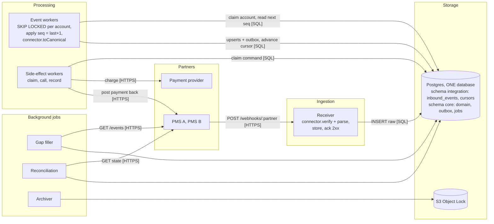

# Practice 01: PMS integration: reliable ingestion + a structure for many PMSs

Rehearsal sheet for one interview question and one architecture: one design, said the same way every time. Business context (PMS, who's who, money flow): [domain notes](../12-domain-rental-payments/01-pms-and-rent-payments.md). Theory: [webhooks](../04-api-design/03-idempotency-pagination-rate-limiting-webhooks.md#consuming-webhooks-the-reliable-receive-pipeline), [messaging](../06-distributed-systems/01-messaging-queues-kafka-sqs.md), [Postgres queues and locks](../03-databases/02-transactions-isolation-locking.md#5-row-level-locks), [ports & adapters / canonical model](../10-system-design/11-application-architecture.md), [crypto](../05-security/02-authentication-authorization.md#0-crypto-building-blocks-hash-hmac-signature-encryption).

---

## The question (usually asked in two steps)

> **Step 1.** A property management company pushes tenant and lease updates to us via webhooks. They retry a failed delivery up to 5 times and don't guarantee order. Design the receiving side so that duplicates don't create duplicate records or payments, older updates don't overwrite newer ones, nothing is lost if we're briefly down, and we can prove what they sent in a dispute.
>
> **Step 2.** We're onboarding a second PMS next month, with a completely different data model. How would you structure the integration code?

What it tests: a pipeline that survives at-least-once, unordered, lossy delivery (step 1), and a separation of **what's the same for every partner** (pipeline, storage, ordering, money rules) from **what's different** (their API, auth, payload shape, quirks), so PMS #3, #4… is small, isolated work (step 2).

**Two kinds of onboarding, say this early in step 2:**
| | New **customer** on a PMS we already support | New **PMS** |
|---|---|---|
| Work | **configuration only**: account row, credentials, timezone, custom-field mapping, enable flag | write **one adapter** module |
| Code changes | none | adapter + tests; core untouched |
| Goal | hours, eventually self-service | days to weeks |

---

## 1. Clarifying questions (the answers pick the design)

1. Does each event carry a **unique event ID** that stays the same across retries?
2. Does the partner stamp a **gapless sequence number** per account (their changelog position: entry #1043 in their append-only log of changes for that account), and is there an **event history API** (`GET /events?after=cursor`)? **The key question.** Events fail in two ways: arrive **reordered** (#7 before #6) or **never arrive** (#6 lost after retries). Timestamps and UUIDv7 only catch the first; a gapless counter catches both.
3. Are events **full state** ("lease 42 is now {…}") or **transitions/deltas** ("tenant moved out")?
4. Volume and latency: events per minute per account; how fast must changes show up?
5. Signing (HMAC shared secret or asymmetric)? Auth for their API (API key, OAuth2, per-customer tokens), rate limits?
6. Is there a **state API** to re-fetch records? Do we also **write back** (post payments into the tenant ledger)?
7. How different is their data (same concepts with other names, or different concepts)? Custom fields per customer? A sandbox?

**Assumed for the main design:** event ID yes; per-account gapless sequence + event API; events can be transitions touching several entities; low volume (tens/s total); HMAC. Partners without sequence numbers: §4.

### Why strict order matters here (have 2 examples ready)
An upsert of the final state can't fix these: each step triggers its own side effect, often moving money.
- `owner_changed` (new payout account) → `rent.collected`: reversed, rent is paid out to the **old owner**.
- `payment_method_changed` → `autopay.enabled`: reversed, we charge the **old/closed bank account**.
- `notice_given` → `notice_withdrawn`: reversed, we stop autopay and start move-out for a tenant who's staying.
- `charge.posted` → `charge.voided` → `charge.posted` (re-issue): the void references a charge we don't have yet.
- Tenant transfer: `moved_out(A)` → `moved_in(B)` → `charges.reassigned`: one operation across 3 entities, so per-entity ordering can't see it.

---

## 2. Architecture

Container view (C4 level 2). Legend: solid = synchronous call, dashed = async message; arrow points from the initiator. Inbox and domain tables live in **one Postgres database** (separate schemas are fine): the worker's transaction must read the event, advance the cursor, upsert domain rows and write the outbox **atomically**. Two instances would turn that into a dual write.


```
                 ┌──────────────────────────── CORE (written once) ─────────────────────────────┐
PMS A ─► pms-a/  │ receiver · inbox · resequencer · gap filler · reconciliation · outbox · metrics │
PMS B ─► pms-b/ ─┼─► PmsConnector port ─► canonical events ─► domain services (validate, apply) ─► DB │
       (adapters │                                                                               │
        = ACL)   └───────────────────────────────────────────────────────────────────────────────┘
```

---

## 3. Ingestion pipeline (step 1)

```
Partner ──POST──► RECEIVER (thin, stateless, autoscaled)
                   1. connector.verifyWebhook: HMAC(secret, timestamp + "." + rawBody), timestamp ≤ 5 min ──► 401 if bad
                   2. connector.parseWebhook → envelopes {externalEventId, accountId, seq, type}
                   3. one tx: INSERT raw event → inbound_events ON CONFLICT (partner_id, external_event_id) DO NOTHING
                              INSERT cursor row (account, last_applied_seq = 0) ON CONFLICT DO NOTHING
                   4. return 2xx                                    (DB down → 503 → partner retries)

EVENT WORKERS (N replicas; Postgres is the queue: "transactional inbox"), loop every ~1 s:
                   BEGIN
                     SELECT c.* FROM stream_cursors c                       -- accounts whose NEXT event is here
                     WHERE EXISTS (SELECT 1 FROM inbound_events e
                                   WHERE e.account = c.account AND e.seq = c.last_applied_seq + 1)
                       AND (c.retry_after IS NULL OR c.retry_after <= now())  -- backoff after a failed attempt
                       AND <account status = 'live'>                          -- kill switch
                     LIMIT 1 FOR UPDATE SKIP LOCKED                         -- another worker has it → take another account
                     apply event seq = last+1:
                       connector.toCanonical → validate → domain upserts by external IDs + outbox rows for side effects
                       mark event applied, last_applied_seq += 1
                   COMMIT, repeat; nothing claimable → sleep ~1 s
                   (accounts with a gap are never claimed: their next event isn't there yet)

GAP FILLER (every minute)       events waiting with seq > last+1 for > N min → connector.fetchEventsAfter(last)
                                → insert (same dedupe); workers pick it up. Not available → alert + full account resync
RECONCILIATION (nightly)        compare our state vs connector.fetchCurrentState per account → drift = alert + fix
ARCHIVER                        inbound_events partitioned by month → old partitions to S3 with Object Lock
```

### Who puts events back in order? We do: the table + cursor is the reordering buffer
Every event is **stored first** (whatever its seq) by the receiver. Workers only ever apply `last_applied_seq + 1`:
| Incoming seq vs cursor | Meaning | Action |
|---|---|---|
| `seq ≤ last` | already applied (a retry/duplicate) | drop |
| `seq == last + 1` | the next one | apply, advance cursor, look for `last + 1` again among stored events |
| `seq > last + 1` | arrived **early** | **keep it** (status `received`), don't apply yet |

Events arrive as **1, 3, 4, 2, 3**:
```
arrives 1 → cursor 0 → apply 1                                                       cursor 1
arrives 3, 4 → early, stored, wait
arrives 2 → apply 2 → stored 3 is next → apply 3 → stored 4 is next → apply 4         cursor 4
arrives 3 (partner retry) → 3 ≤ 4 → already applied, drop
```
If 2 never arrives, 3 and 4 wait; after N minutes the gap filler fetches #2 (or alerts + resyncs).

### Tables
```sql
inbound_events(
  id bigserial, partner_id, account_id, external_event_id, seq bigint, event_type,
  raw_body bytea, headers jsonb, signature text, received_at timestamptz,
  status text,            -- received | applied | failed
  error text,
  UNIQUE (partner_id, external_event_id)
)                          -- partitioned by month (retention), NOT per customer
CREATE INDEX ON inbound_events (partner_id, account_id, seq);   -- "is the next event here?" = index lookup

stream_cursors(partner_id, account_id, last_applied_seq bigint, updated_at,
  attempts int DEFAULT 0, retry_after timestamptz,   -- backoff; reset after a success
  PRIMARY KEY (partner_id, account_id))

partner_accounts(                            -- per-customer configuration: data, not code
  partner_id, account_id, status,            -- onboarding | shadow | live | paused (kill switch)
  credentials_secret_arn, webhook_secret_arn, -- in Secrets Manager, never in the table
  timezone,                                  -- IANA, e.g. 'America/New_York'
  field_mapping jsonb,                       -- custom fields: {"cf_17": "lease.petDeposit"}
  PRIMARY KEY (partner_id, account_id))
```

### How each requirement is met
| Requirement | Mechanism |
|---|---|
| **Duplicates** | `UNIQUE(partner_id, external_event_id)` at insert; `seq ≤ last_applied_seq` dropped at apply; business writes are upserts by the partner's IDs; money side effects go through the outbox with idempotency keys downstream |
| **Order** | Ordering scope = **partner account** (events touch lease + tenant + unit). Apply only `seq == last + 1` under a row lock on the cursor: serial per account, parallel across accounts |
| **Missing events** | Gapless sequence makes a gap visible → gap filler; no event API → alert + resync |
| **Our downtime** | Receiver acks only after the raw row is committed. DB down → 503 → partner retries over hours. Workers down → events wait in the table |
| **Failures while applying** | Transient: tx rolls back, cursor doesn't move, the event is still "next" → retried on the next poll with backoff (`attempts`, `retry_after`). After N → event `failed`, **that account stalls**, alert. A DLQ that stops instead of skipping |
| **Proof / disputes** | Raw bytes, headers, signature, `received_at` append-only; long-term copy in S3 Object Lock (compliance mode, e.g. 7 years) |
| **Bugs in our mapping** | Fix the mapper, reset the account's cursor/state, **replay** stored raw events |
| **Silent failures** | Metrics per partner/account: apply lag, gap age, failed events, reconciliation drift, "no events from partner in N hours" |

---

## 4. Ingestion modes: when the partner can't give a gapless counter

The adapter declares `capabilities`; the core picks the mode. **Mode A is the main design. Mode B and the other options are the fallbacks**, ranked.

| | **Mode A: event stream** (`sequence: 'gapless'`) | **Mode B: change signal + re-fetch** (`sequence: 'none'`) |
|---|---|---|
| Webhook means | "this exact change happened, it's #42 for account 77" | "something about lease 42 changed" (content not trusted for order) |
| Worker does | resequencer: apply only `seq = last + 1`; `toCanonical` → transition events | `fetchCurrentState(lease 42)` → current record + their version → upsert `WHERE stored_version < incoming` → diff old vs new → emit **our own** events (`RentChanged`, `LeaseEnded`) |
| Webhook order | matters, enforced by the cursor | irrelevant: we always read the latest |
| Missing webhook | detected (gap) → gap filler | not detected → reconciliation catches it |
| Limits | needs partner support | one API call per change (rate limits); intermediate states and multi-entity transitions invisible |
Mode B example: "lease 42 changed" webhooks at 10:00 and 10:01 arrive reversed. Both trigger a fetch, both get version 9; the first upsert applies it, the second finds version 9 already stored and does nothing.

**All the alternatives, ranked** (theory: [webhooks notes](../04-api-design/03-idempotency-pagination-rate-limiting-webhooks.md#strict-ordering-when-events-must-be-applied-in-sequence)):
1. **Resequencer per partner account** on a gapless counter (Mode A). The answer.
2. **Pull from their API in order** (an event list endpoint, the webhook only wakes the poller). A true changelog with a cursor is as strong as #1; `modified_since` polling returns current rows, not changes, so two edits between polls collapse into one.
3. **Resequencer per entity** (per-lease counter): breaks on multi-entity events.
4. **Precondition check + delayed retry** ("update for a lease that doesn't exist yet → retry later"): timing-based, can't see a missing middle event.
5. **Re-fetch + version guard + derive our own events from state diffs** (Mode B) + reconciliation: converges to the right final state, misses intermediate and multi-entity transitions.
If money-moving transitions depend on order, push the partner for a changelog with a counter.

---

## 5. Gap filler vs reconciliation: why both

| | Gap filler | Reconciliation |
|---|---|---|
| Trigger | a **known** problem: account 77 has #43, #44 but not #42 for > N min | no known problem; a **schedule** (nightly; Mode A can be weekly or sampled) |
| Scope | exactly the missing events | every record of an account, ours vs theirs |
| Modes | Mode A only | all; in Mode B it's the **main** safety net |
| Analogy | "page 42 is missing, request page 42" | "compare the whole book against the original" |

**A gapless sequence proves we received everything the partner *sent*, not that what they sent matches their data.** Reconciliation catches what no sequence can:
- **partner-side changes that never produced an event**: a bulk import, an admin edit straight in their DB, a code path that bypasses their changelog;
- **our bugs that "succeeded"**: a mapper that parsed `"1,250.00"` as `1` applied cleanly, no gap, no error;
- deletes their feed doesn't emit; a partner restoring from backup (sequence rewinds); a gap filler that itself failed; manual fixes on our side.
In fintech this is the same discipline as bank reconciliation: trust, but verify. Cheap version: compare per-account counts and hashes first, drill down only on mismatch; any drift is an alert because it means the real-time path is losing or corrupting data.

---

## 6. Code structure: ports & adapters + canonical model (step 2)

- **Canonical model**: our own `Property, Unit, Tenant, Lease, Charge, Payment` + events (`LeaseUpserted`, `ChargePosted`, `OwnerChanged`). The core only sees this. Definition: [application architecture §3](../10-system-design/11-application-architecture.md#3-integrating-many-external-systems-canonical-model--anti-corruption-layer).
- **Anti-corruption layer**: each adapter (parser + pure mapper) translates *their* model into *ours* at the border.
- **Port** = one interface every adapter implements; **adapter** = one folder per PMS; a registry maps `partner_id → connector`.

### The port
```ts
interface PmsConnector {
  readonly partner: 'pms-a' | 'pms-b';
  readonly capabilities: {
    sequence: 'gapless' | 'none';          // Mode A (resequencer) or Mode B (re-fetch + version guard)
    eventApi: boolean;                     // can the gap filler fetch missing events?
    writeBack: boolean;                    // can we post payments into their ledger?
  };
  verifyWebhook(req: RawRequest, secret: string): void;                   // throws if bad signature
  parseWebhook(raw: RawRequest): InboundEvent[];                          // envelopes, no mapping yet
  toCanonical(event: InboundEvent, ctx: AccountConfig): CanonicalEvent[]; // PURE: the mapper
  fetchEventsAfter?(account: AccountConfig, cursor: string): Promise<InboundEvent[]>;
  fetchCurrentState(account: AccountConfig, ref: EntityRef): Promise<CanonicalEntity>;
  postPayment?(account: AccountConfig, p: Payment): Promise<ExternalRef>; // idempotent by our payment ID
}
```

### Where each method is called
| Method | Called by | Example |
|---|---|---|
| `verifyWebhook` | receiver, first thing | PMS A: `HMAC(secret, ts + body)` in `X-Sig`; PMS B: Basic auth + IP allowlist |
| `parseWebhook` | receiver, before the INSERT | one PMS A webhook carrying 3 changes → 3 rows in `inbound_events` |
| `toCanonical` | event worker, inside the apply tx | `{"Lse_Rent":"1,250.00 USD"}` → `RentChanged{ leaseId, amount: 125000, currency: 'USD' }` |
| `fetchEventsAfter` | gap filler | `GET /v2/changes?after=1042&account=77` |
| `fetchCurrentState` | reconciliation; Mode B worker | `GET /leases/42` → canonical `Lease` |
| `postPayment` | side-effect worker after a payment completes | `POST /receipts { externalRef: pay_123 }` |
| `capabilities` | core | PMS A `{sequence: 'gapless', eventApi: true}`, PMS B `{sequence: 'none'}` |

### The canonical model, concretely
```ts
type Money = { amount: bigint; currency: 'USD' | 'EUR' | 'ILS' };   // minor units
type Ref   = { partnerId: string; externalId: string };              // their ID, for traceability

interface Lease {
  id: string; ref: Ref; unitId: string; tenantIds: string[];
  startDate: LocalDate; endDate: LocalDate | null;                    // calendar dates, no timezone
  rent: Money; dueDay: number;
  status: 'future' | 'active' | 'notice_given' | 'ended';
}
interface Charge { id: string; ref: Ref; leaseId: string; amount: Money; dueDate: LocalDate;
                   kind: 'rent' | 'late_fee' | 'utility' | 'deposit' | 'other'; voided: boolean }

type CanonicalEvent =
  | { type: 'LeaseUpserted'; lease: Lease }
  | { type: 'ChargePosted';  charge: Charge }
  | { type: 'ChargeVoided';  chargeRef: Ref }
  | { type: 'OwnerChanged';  propertyRef: Ref; payoutAccountRef: Ref; effectiveDate: LocalDate }
  | { type: 'TenantMovedOut'; leaseRef: Ref; tenantRef: Ref; date: LocalDate };
```
PMS A calls a lease `Tenancy` with `Lse_Rent: "1,250.00 USD"` and status `"NTV"`; PMS B nests leases under tenants with `rent_cents: 125000` and `status: 3`. Both become the same `Lease`; payments, autopay, payouts and UI are written once against it.

**The adapter describes, the core decides and writes.** Adapters return `CanonicalEvent[]`; the core validates invariants, upserts, writes history and appends outbox commands ("schedule autopay", "post receipt back"). An adapter can't corrupt data or move money on its own.

### Folder layout (modular monolith, one service)
```
integrations/
  core/            pipeline, resequencer, gap filler, reconciliation, canonical model, validation, metrics
  connectors/
    pms-a/         client.ts (auth, rate limiter, retries) · schemas.ts (zod for THEIR payloads)
                   mapper.ts (pure: theirs → canonical) · fixtures/ (recorded real payloads) · *.spec.ts
    pms-b/         same shape
```
One microservice per PMS only for separate teams or very different scaling; otherwise deployment overhead with no benefit.

---

## 7. Mapping and validation (where real bugs live)

| Their data | Rule |
|---|---|
| Money `"1,250.00 USD"`, `1250.5`, `"125000"` (cents?) | **integer minor units + currency**, never floats; confirm units from docs + fixtures |
| Dates without timezone (`"2026-11-01"`) | lease dates are **calendar dates** (`date`), not instants; convert only when needed, with the **property's** timezone |
| Timestamps without offset | interpret in the account's timezone from config; store `timestamptz` |
| Enums (`"ended"`, `"Past"`, `"NTV"`) | explicit mapping table per adapter; **unknown value → fail loudly** (event `failed` + alert) |
| Custom fields | config-driven `field_mapping`; unmapped kept in `jsonb extensions`, not dropped |
| IDs | keep `external_id` + `partner_id`; our own UUIDs internally |
| Bank accounts / payout destinations | never taken from the payload; verified with us at onboarding (fraud vector) |

Two validation layers: **shape** in the adapter (zod: "they changed their API") and **business invariants** in the core, same for all partners (end ≥ start, amount ≥ 0, currency supported, tenant belongs to the unit's property: "the mapping is wrong"). Failure → event `failed`, account stalls, alert.

---

## 8. Isolation: one partner's bug can't hurt the others
- Adapters can't write to the DB (§6).
- Failure domains per account: a failing account stalls alone; per-partner **rate limiter, circuit breaker, concurrency cap** on outbound calls.
- **Kill switch** per partner/account (`status = paused`): events keep being stored, processing stops, resume from the cursor. [Breaker vs kill switch](../06-distributed-systems/03-resilience-patterns.md#3-circuit-breaker).
- Metrics and alerts **tagged by partner**.
- **Shadow mode** for a new adapter or customer (`status = shadow`): process real events, record proposed changes, don't commit or trigger payments; flip to `live` when the diff is clean. [Shadow mode](../08-devops-cloud/01-kubernetes-probes-and-deployment-strategies.md#shadow-mode-dark-launch-traffic-mirroring).
- **Replay** from raw events after a mapper fix.

---

## 9. Workers and side effects

**Postgres row locks are the coordinator.** Every event worker runs the same loop; `FOR UPDATE SKIP LOCKED` on the account's cursor row means a held account is skipped, not waited on. Any worker can take any account, at most one at a time: serial within an account, parallel across accounts. A crash rolls back and releases the lock. Never one instance per customer; cron only for the periodic jobs (gap filler, reconciliation, archiver).

**External calls (Stripe, PMS write-back) never run inside the event transaction.** Applying an event is DB-only (milliseconds) and appends an outbox command; a side-effect worker runs **claim → call → record** (the repo's `PaymentChargeService`):
```
event worker A: tx (account 1, event 41): upsert lease, append outbox "charge pay_9"   COMMIT  ~5 ms
event worker B: tx (account 2, event 7):  ...                                           COMMIT  ~5 ms
side-effect C:  tx: claim pay_9 (UPDATE … WHERE charge_attempted_at IS NULL)            COMMIT
                Stripe call, NO transaction, idempotency key = pay_9                    ~1 s
                tx: guarded transition PENDING → COMPLETED + ledger + outbox            COMMIT
```
- Crash between claim and record → `UNKNOWN`, a resolver asks Stripe by idempotency key; never call twice blindly.
- Side effects are async, so event 42 may be applied before charge #41 hits Stripe. Safe because the command **carries the data decided at that moment** (amount, payout account snapshot): a later `OwnerChanged` can't redirect an already-decided payment. If side effects must be strictly ordered per account, process that account's commands in order too.
- Side-effect commands are independent, so **outbox → SQS** with managed retries/DLQ is a good fit here (the repo does this for `payments-charge`).

---

## 10. Why Postgres for ingestion (and where SQS, Kafka, Cassandra fit)

**Why the inbox is a Postgres table, not SQS:**
1. The raw events must be in Postgres anyway (audit, replay), so the table already is the queue. SQS would add a hop and a dual write (insert + send can't share a transaction).
2. SQS can't express "apply #42 only after #41, wait for a missing #41"; FIFO only keeps arrival order.
3. **SQS's DLQ semantics are wrong for an ordered stream**: "after N failures, set aside and continue" applies #43 on top of a missing #42. We need "stall this account, alert".
4. Retries are still there (§3, failures while applying), and "why is account 77 stuck?" is one SELECT.
5. Tens of events/s: trivial for Postgres.

**Can Kafka be the transport?** Yes: CDC (Debezium) or an outbox relay from `inbound_events` into a topic keyed by account. But it doesn't remove the hard parts and makes one of them worse:
- Kafka keeps **arrival** order per partition, not the partner's sequence, so the resequencer and its cursor stay (in the DB or a Kafka Streams state store).
- **Stop-on-failure blocks the whole partition**: every account hashed into it stalls, not just the broken one.
- More infrastructure (MSK, CDC/relay) for tens of events/s.
Where Kafka **does** fit: **downstream of ingestion**. Postgres does the hard part (resequencing, gaps, stop-on-failure); Kafka distributes the **already ordered** result to several services (payments, analytics, notifications, search), each at its own pace, with replay:
```
inbound_events ─► worker applies seq = last+1 ─► same tx: outbox row (canonical event, per-account seq)
outbox ─► relay (Debezium CDC reading the WAL in commit order, or a polling publisher) ─► Kafka topic, key = account
```
- Order can break at three hops; each needs one guarantee:
  | Hop | How order could break | Guarantee |
  |---|---|---|
  | worker → outbox | — | free: the resequencer applies #41 before #42, so account 77's outbox rows get ids 500 (#41), 501 (#42) in order |
  | outbox → relay | relay thread X takes row 500, thread Y takes row 501, Y is faster → Kafka gets #42 first | relay sends one account's rows **one at a time, by id** (a polling publisher); or **Debezium**, which reads Postgres's write-ahead log (its journal of committed changes) in commit order |
  | relay → Kafka | batch with #41 times out and is retried, while the batch with #42 already succeeded → stored as #42, #41 | **idempotent producer** (`enable.idempotence=true`, `acks=all`): the broker numbers each producer's batches per partition and rejects out-of-order or duplicate ones, so the retry lands in its right place |
  Then same key → same partition → consumers read in order.
- Key by **account** (finest scope that needs order) rather than by tenant, so load spreads across partitions.
- Consumers are still at-least-once: each keeps "last seq applied per account" and drops `≤ last`, the same rule as our resequencer, just trivial now because there are no gaps.
- Worth it only when several consumers need the events; for one consumer it's extra infrastructure.
- "Kafka partitioned by account" means account IDs are **hashed into a fixed set of shared partitions** (say 24), not one partition per account. So:
  - **strict order per account**: yes;
  - **fairness: no**: no per-account caps, and a huge account's backlog delays every account sharing its partition;
  - **stop on failure: stops the whole partition**, every account in it, unless the consumer keeps its own "paused accounts" state, which is a table again.
  - The key point: **each partition holds a MIX of accounts**, and a partition is read strictly in order by one consumer. So when one account's event is stuck (failing, or waiting), every other account in that partition is stuck behind it, even though they have nothing to do with each other.
  - **Why Postgres doesn't have this problem:** there are no lanes. Each account has its own cursor row, and workers claim **accounts**, not partitions: any free worker takes any account whose next event is ready. A stuck account is just a row no one can claim (its next event is failed, paused or missing), so the claim query skips it and everyone else keeps flowing. Blocking is per account, not per partition.
    Analogy: Kafka = 24 checkout lanes, each customer assigned to a lane by hash; one customer with a problem blocks the whole lane. Postgres = one waiting room; any free cashier calls any customer who's ready; a customer with a problem waits aside alone.
- **An event that always fails** (e.g. #41 has an amount our code can't parse): Kafka itself does nothing; it's just a log the consumer reads. The consumer code must choose: retry in a loop (never gets past #41, so #42 and every other account in that partition wait behind it), skip it (commit the offset: lost), or copy it to a retry/dead-letter topic you built yourself and move on (for an ordered stream, moving on = skipping). Compare: SQS retries and dead-letters on its own (but skips); our Postgres cursor retries with backoff, then pauses **only account 77** and alerts. The retry/stop logic doesn't disappear with Kafka; you write it in the consumer instead.

**Not Cassandra for the raw log:** tiny write volume, and we'd lose the single transaction across dedupe, raw log and business writes. Pays off at 100k+ writes/s or multi-region writes.

**When to add a broker in front:** polling latency (~1 s) too slow → `LISTEN/NOTIFY` or an SQS wake-up, keeping polling as the safety net; volume beyond one Postgres.

---

## 11. Testing
- **Mapper unit tests on recorded real payloads**: golden files `theirs.json → expected canonical.json` (mappers are pure, so fast, no mocks).
- **Contract tests** for each client against the partner's sandbox (auth, pagination, rate-limit headers), nightly.
- **Shared adapter test suite** every connector must pass (signature rejection, duplicate event, out-of-order and gap handling, unknown enum → failure, money parsing). PMS #3 = implement the port + make the suite green.
- Pipeline integration tests on real Postgres (Testcontainers): arrivals `1, 3, 4, 2, 3`, crash mid-apply, concurrent workers.
- Shadow mode on a real customer before go-live.

---

## 12. The spoken answer (~3 minutes): practice until it comes out in one go

> "First I'd ask the partner what they stamp on events: a unique event ID, a sequence number, and whether there's an event history API. A consumer can't reconstruct an order the producer never recorded, and order matters here: if 'owner changed' is applied after 'rent collected', we pay rent to the old owner. I need a gapless counter, not a timestamp, because events can also go missing and only a counter shows a gap. I'll assume an event ID and a gapless sequence per account.
>
> I split receiving from processing. The receiver is thin: it verifies the HMAC signature on the raw body, inserts the raw event into an inbound events table in Postgres with a unique constraint on partner and event ID, which removes duplicates, and only then returns 2xx. If our database is down we return 503 and the partner's retries cover us.
>
> Processing is ordered per partner account, because one event can touch a lease, a tenant and a unit. Postgres is the queue: workers poll for accounts whose next event has arrived and claim one with SKIP LOCKED, so each account is processed by one worker at a time. The worker applies only sequence last-plus-one, writes upserts plus outbox rows for side effects, and advances the cursor in one transaction. Duplicates are dropped, early events wait, and a gap filler fetches missing events from the partner's API after a few minutes. If applying fails, the cursor doesn't move, it retries with backoff, and after a few attempts that account stalls with an alert, because skipping an event in a money stream is worse than waiting. Payments and write-backs to the PMS run as separate jobs outside the transaction, with idempotency keys.
>
> For many PMSs I use ports and adapters with a canonical model. The core owns our own Lease, Charge, Tenant and events like ChargePosted, plus this whole pipeline. Each PMS gets an adapter implementing one interface: verify and parse the webhook, map it to canonical events with a pure function, fetch missing events or current state, and write payments back. The adapter declares capabilities; a partner without sequence numbers gets the fallback mode, where a webhook is just a signal and we re-fetch the current state with a version check. A new customer on a supported PMS is configuration only.
>
> Mappers are where bugs live, so they're tested on recorded real payloads: money as integer cents plus currency, lease dates as calendar dates, unknown enums fail loudly. Adapters never write to the database, failures stall only that account, each partner has its own rate limiter, circuit breaker, metrics and kill switch, and new adapters go live in shadow mode. The raw events are the audit trail, archived to S3 with Object Lock, and let us replay after a fix. A nightly reconciliation compares our data with the PMS, because a gapless sequence proves we got everything they sent, not that what they sent is right. And payment status never comes from the PMS: it comes from our ledger and the payment provider."

---

## 13. Follow-up drill

**The partner needs a result back. How?** The webhook response is only a receipt (2xx = "stored"). Results go back by **write-back** (we call their API via outbox → side-effect worker, idempotent by our ID; the PMS default), **our webhooks** (we become the provider: signing, retries, event IDs, sequence numbers), or **they poll us** (`202 Accepted` + `Location: /operations/123`, or our `GET /events?after=cursor`).

**Isn't dropping `seq ≤ last` a hack?** No, it's standard: TCP discards acknowledged segments, Kafka consumers resume from committed offsets, DB replicas skip applied WAL. The real trade-off is head-of-line blocking: a missing #5 holds #6 and #7 for that account; other accounts keep flowing.

**Why order per account and not per lease?** Events span entities (a transfer touches two units, a lease and charges).

**Several worker machines: how do they avoid the same account?** `FOR UPDATE SKIP LOCKED` on the cursor row; Postgres is the coordinator (§9).

**Why no SQS? Don't we lose retries and the DLQ?** §10: the table is already the queue, SQS can't wait for a gap, its DLQ skips; retries are built into the cursor.

**Could Kafka be the transport?** §10: possible, but the resequencer stays and a failure blocks a whole partition; use Kafka downstream for canonical events.

**Wouldn't Kafka handle failures automatically, so we need fewer jobs?** No, it moves the work. Kafka's "automatic" part is redelivery after a consumer crash (re-read from the last committed offset), and our design already gets that for free: a crashed worker's transaction rolls back and the event is still "next" (no reaper needed here; a reaper only exists for claim-then-work jobs with leases). For an event that **always** fails, Kafka has no retry/backoff/DLQ: the consumer either retries forever, blocking the whole partition, or you build retry and DLQ topics yourself. And the nightly **reconciliation** is a business check against the PMS's data (did we miss or corrupt anything?), not failed-job cleanup; it's needed whatever the transport.

**What changes at 100,000+ events/s?** One Postgres (thousands/s) is no longer enough. Two routes: **shard Postgres by account** (each shard keeps the same per-account cursor design; Citus or N databases), or **Kafka keyed by account + key-level isolation** (a parallel consumer or the parking-lot pattern), idempotent consumers, and per-key state ("last seq applied", gap buffering in a Kafka Streams state store). If we control the producer (our own outbox → Kafka), there are no gaps to wait for, which removes most of the resequencing work.

**Are `inbound_events` and the domain tables separate databases?** No: one Postgres database (separate schemas are fine). The worker's transaction must cover reading the event, advancing the cursor, upserting domain rows and writing the outbox; two instances would make that a dual write.

**Why not SQS FIFO with group = account?** FIFO preserves *enqueue* order, can't fix the partner's reordering; its dedup window is 5 minutes, partner retries span hours.

**A malformed event in the middle of the stream?** Can't skip it: `failed`, stall that account, alert; fix the mapper or get a corrected event, resume. Stalling beats applying later events on top of a missing one.

**One account is huge?** Serial per account handles tens–hundreds of events/s, far above PMS volume. Narrow the scope (per property) only if events never cross properties.

**Why their sequence/timestamp, not our receive time?** Our receive time includes the delays that caused the reordering.

**Could the partner manipulate sequence numbers or timestamps?** They're the source of truth for their own data anyway. The risk is bugs (future timestamps, sequence resets): validate and alert.

**How do you prove what they sent?** Raw bytes + signature + received time in S3 Object Lock. HMAC is a shared secret, so either side could forge: **"HMAC is the default; I'd use asymmetric signatures if we need proof against the sender."**

**Exactly-once?** No such thing over a network: at-least-once delivery + idempotent processing = effectively once.

**Why not one microservice per PMS?** Deployment and ops per partner with no benefit at this size; module boundaries give the isolation.

**Why a canonical model?** N partners × M consumers would each need every format; with it: N mappers, M consumers of one model.

**The PMS changes its API without telling us.** Shape validation fails → events `failed`, account stalls, partner-tagged alert; update the adapter, replay. Nothing applied wrongly.

**A field the canonical model doesn't have?** One customer: `field_mapping` + `extensions jsonb`. Several partners and the product needs it: add it to the canonical model.

**Where do credentials live?** Secrets Manager, referenced from `partner_accounts`; two valid secrets during rotation; never in code or logs.

**How do you make onboarding faster over time?** Config instead of code, the shared adapter test suite, shadow mode, an onboarding checklist, partner-tagged dashboards, later a mapping UI for customer success.

---

## 14. Traps (don't say these)
- "SQS will store it if we're down" (SQS is behind our endpoint).
- "FIFO solves ordering" (only the order it received).
- "Use our timestamp" (that's the reordered one).
- "Exactly-once delivery."
- Cassandra/Kafka for tens of events per second.
- Skipping a failed event in an ordered money stream.
- Infrastructure per customer (a queue, database or partition per customer): partition by **time**, keep `partner_id/account_id` columns.
- `if (partner === 'pms-a') … else …` scattered through the core.
- Floats for money; treating `"2026-11-01"` as UTC midnight; silently defaulting unknown enums.
- Adapters writing straight to domain tables; taking payout bank accounts from the payload.
- "One worker per customer" (one worker *at a time* per account, any worker).
- Calling Stripe inside the event transaction.
