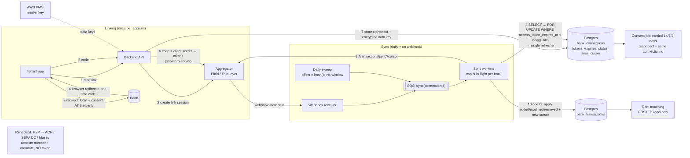

# arch-01. Open banking account linking and transaction sync

*Integrations · Medium*

## The question

Tenants link their bank account through an open-banking provider so we can verify account ownership, check balance before a debit, and match incoming transfers to rent. We expect 50k linked accounts. Access tokens live minutes to an hour, and consent expires after a period set by the regulator or the bank. Design linking, token refresh and a daily transaction sync.

**Then:** A month in, ~6% of links break every month (consent expired, password changed, consent revoked at the bank), and some banks give a transaction a new ID when it goes from pending to posted. How do you handle re-consent and duplicates?

Try it first: talk through clarify → design → deep dives out loud, then open the answer.

<details>
<summary>Model answer</summary>

## Architecture diagram



- **1–6 Linking.** The bank sends the **browser** back with a one-time code (a redirect, not a webhook). The backend swaps the code + client secret for tokens server-to-server; tokens never reach the frontend.
- **7 Storage.** Envelope encryption: KMS hands out a data key (plain + encrypted); the token is encrypted with the plain key, and Postgres stores ciphertext + encrypted data key. A DB dump alone is useless.
- **Two clocks.** `access_token_expires_at` (minutes–hours) decides refreshes; `consent_expires_at` (90–180 days) only drives reminders. A refresh can't extend consent.
- **8 Single refresher.** Providers rotate refresh tokens (each works once; reuse looks like theft). The condition sits inside the locked query, so Postgres re-checks it after waiting: the second worker gets 0 rows. Others keep using the old access token until its own expiry.
- **Sync triggers.** A webhook only says “go fetch”; a daily sweep syncs every connection anyway (lost webhooks), spread by `hash(id)`, capped per bank.
- **9–10 Cursor sync.** The provider returns added / modified / removed + a new cursor; all applied in one transaction with the cursor, so a crash can't lose or duplicate.
- **Matching.** Pending transactions can be cancelled and change ID when posted: apply the provider's *removed* list and match rent on **posted** rows only.
- **Re-consent** uses the provider's reconnect mode: same connection id, so cursor and history survive.
- **Debits don't use the token.** Rent is pulled through the clearing network with account number + mandate. The balance check is a soft signal: never block the debit on it.

## Clarifying questions

- Direct bank APIs or an aggregator (Plaid, TrueLayer, Salt Edge, a local Israeli provider)? → assume: one aggregator; it handles bank-specific auth and gives us one token per connection plus webhooks.
- Which regime? → assume: it varies. EU PSD2 RTS now allows up to 180 days between SCA re-authentications for AIS through an AISP; the UK replaced bank re-authentication with a 90-day reconfirmation to the TPP; Israel's open-banking rules (Bank of Israel directive) have their own limits. Store the expiry the provider returns, never hardcode one number.
- What is the data for? → assume: ownership check at link time, on-demand balance before a debit, daily transactions for matching.
- History on first link? → assume: request 12 months; banks return 90 days to 24 months.
- Freshness? → assume: daily plus provider "new data" webhooks; nothing real-time.
- Payment initiation (PIS) too? → assume: no, read-only (AIS). Debits run on a separate mandate.

## Design

**Components:** Link API, token service, sync workers (SQS-fed), consent monitor (daily job), Postgres.

1. **Link.** Backend creates a link session at the provider (our user id, redirect URI). Frontend opens the provider's hosted flow; the bank login and OAuth consent happen there. Provider returns a one-time code; backend exchanges it server-side for the access token (and refresh token, if the provider exposes one). `state` parameter against CSRF; PKCE where the flow is ours.
2. **Store.**
```sql
bank_connections(id, user_id, provider, provider_item_id, status,  -- active|reauth_required|expired|revoked|error
  consent_expires_at timestamptz, access_token_enc bytea, refresh_token_enc bytea,
  token_expires_at timestamptz, sync_cursor text, last_synced_at, error_code,
  UNIQUE (provider, provider_item_id))
bank_transactions(id, account_id, provider_txn_id, pending_txn_id, amount_minor bigint, currency,
  booked_date date, status,  -- pending|posted
  removed_at, UNIQUE (account_id, provider_txn_id))
```
Tokens encrypted with KMS envelope encryption; never logged.
3. **Refresh.** Before a call, if `token_expires_at < now() + 60s`, refresh under `SELECT … FOR UPDATE` on the connection row. Commit the new tokens before using them.
4. **Sync.** Provider webhook ("updates available") or the daily sweep enqueues `sync(connection_id)`. The worker calls the provider's cursor-based sync (Plaid `/transactions/sync` returns `added`, `modified`, `removed`, `next_cursor`), and in one transaction upserts added/modified, sets `removed_at`, saves the cursor. 50k connections daily is ~0.6 calls/s; spread with jitter, cap concurrency per bank.
5. **Consent lifecycle.** Daily job: `consent_expires_at` within 14/7/2 days → notify the tenant with a re-consent link (provider "update mode" keeps the same connection id). Errors such as `ITEM_LOGIN_REQUIRED` or `invalid_grant` → `reauth_required`, stop syncing, notify.
6. **Autopay does not depend on this connection.** Debits use the stored debit authorization and verified account number. An expired AIS consent loses balance checks and matching, not rent collection.

**Clarified in rehearsal**
- **Linking flow**: the bank redirects the **browser** back with a one-time code (not a webhook); the backend exchanges it server-to-server with the client secret. Tokens never reach the frontend.
- **Two clocks**: `access_token_expires_at` (minutes–hours) decides when to refresh; `consent_expires_at` (90–180 days, set by regime/bank) only drives reminders. A refresh can't extend consent; when consent is over, the refresh itself fails (e.g. `invalid_grant` / login required) → `status = reauth_required`, stop syncing, notify.
- **Shared token, single refresher**: many providers rotate refresh tokens (each works once; reuse looks like theft and can revoke the grant), so workers can't refresh independently. One access token per connection in the DB; refresh under a row lock with the condition inside the lock:
```sql
BEGIN;
SELECT * FROM bank_connections
WHERE id = $1 AND access_token_expires_at < now() + interval '60 seconds'
FOR UPDATE;
-- 1 row → refresh at provider, UPDATE new access + refresh token, COMMIT
-- 0 rows → someone already refreshed: COMMIT, read the row, use the token
```
Postgres re-evaluates the `WHERE` on the newly committed row after waiting, so the second worker gets 0 rows. Other workers keep using the old access token meanwhile (it stays valid until its own expiry); refresh ~60 s early so in-flight calls finish.
- **Tokens at rest**: envelope encryption: store ciphertext + KMS-encrypted data key; decrypt via KMS (IAM-checked, logged). Hashing/salt don't apply: the token must be sent again.
- **Sync**: store the provider's **cursor** per connection, saved in the same DB transaction as the added/modified/removed transactions; a webhook ("new data") only triggers a sync, a daily sweep syncs every connection anyway (lost webhooks); spread the 50k daily syncs with a stable offset (`hash(id) % window`) and cap concurrency per bank.
- **Re-consent** uses the provider's reconnect/update mode: same connection id, so cursor and history survive (a fresh link creates a new connection and duplicate history).
- **Debits don't use the token**: rent is pulled through the clearing network (ACH / SEPA Direct Debit / Masav) with the account number + the tenant's signed debit authorization (mandate, valid until cancelled). Open banking only verifies the account at setup and adds optional balance checks and matching.

## Deep dives

**1. Refresh-token rotation race.** Many providers rotate refresh tokens: using one invalidates it. Two workers refreshing at once → the second gets `invalid_grant` and we mark a healthy connection broken. Chosen: single-flight refresh per connection (row lock), new tokens committed before use. Rejected: each worker refreshing independently. Remaining gap: a crash after the provider issued new tokens but before commit loses them; some providers allow a short reuse window, otherwise the user re-consents. Alert on the rate.

**2. Pending to posted.** Many banks give the posted transaction a new ID. Some providers link them (Plaid's `pending_transaction_id`); others send "removed pending" + "added posted". Chosen: follow the provider's removed/added lists exactly and never match rent against a pending transaction. Rejected: dedupe by amount + date + description; two identical 1,500.00 transfers on one day are legitimate.

**3. Re-consent (the twist).** Prompt before expiry, not after: 14/7/2-day reminders with a one-click re-consent that keeps the connection id, so history and cursor survive. After expiry or revocation: stop calling (calls fail anyway, and using data beyond consent is a compliance problem), keep or delete stored data per the consent terms and retention policy. Measure re-consent rate per bank; a bank with high breakage often has a short consent period or a fragile login.

**4. Consent purpose.** Data may be used only for the purposes the user consented to. Rejected: reusing transaction data for marketing or credit decisions not covered by the consent.

## Traps

- Hardcoding "90 days" as the consent period everywhere. It differs by regime and bank; the EU moved to 180 days for AIS via an AISP, the UK moved to TPP reconfirmation.
- Refreshing tokens from several workers in parallel; with rotating refresh tokens this breaks connections.
- Saving the sync cursor in a separate transaction from the data, or before it; a crash between them loses transactions.
- Matching rent to pending transactions; their IDs and amounts can change or disappear.
- Making autopay require a live AIS connection; consent expiry then becomes missed rent.
- Storing or logging tokens in plaintext.

## Say it (60–90 s)

I'd use one aggregator so we get one token per connection and webhooks instead of per-bank integrations. Linking runs in the provider's hosted flow; our backend exchanges the one-time code for tokens and stores them encrypted with KMS. Each connection row keeps status, the consent expiry the provider reports, the token expiry and a sync cursor. I don't hardcode a consent period, because the EU, UK and Israel all differ. Token refresh is single-flight per connection under a row lock, because refresh tokens often rotate and two parallel refreshes kill the connection. Sync is cursor-based: a webhook or a daily sweep enqueues a job, the job pulls added, modified and removed transactions and saves them together with the new cursor in one transaction. Rent matching only uses posted transactions, because pending ones can change IDs. A daily job reminds tenants 14, 7 and 2 days before consent expiry with a re-consent link that keeps the same connection, and errors like login required stop syncing and notify the tenant. Autopay never depends on this link; it runs on the debit authorization, so an expired consent costs us data, not rent.

## Follow-ups

**Q:** The provider's webhook is lost. Do you miss transactions?
**A:** No. The webhook only triggers a sync; the daily sweep runs the same cursor sync for every active connection.

**Q:** The tenant revokes consent at their bank.
**A:** The next call fails or the provider sends a revoked event. Mark `revoked`, stop jobs, apply the retention policy, and tell the tenant what stops working.

**Q:** Balance check before a debit takes 4 seconds at some banks.
**A:** Treat it as a soft signal with a ~3 s timeout and fall back to the last known balance. Some banks serve cached balances anyway. Never block a debit only because the balance call failed.

**Q:** Why not let each worker get its own access token from the refresh token?
**A:** With refresh-token rotation the first refresh kills the old refresh token, so the second worker gets `invalid_grant` and may trigger theft detection that revokes the connection. Without rotation it works but wastes refresh calls; the shared token with a single refresher is the safe default.

</details>

## Theory in the notes

- [12-domain-rental-payments/01-pms-and-rent-payments.md](../../12-domain-rental-payments/01-pms-and-rent-payments.md)
- [05-security/02-authentication-authorization.md](../../05-security/02-authentication-authorization.md)
- [04-api-design/03-idempotency-pagination-rate-limiting-webhooks.md](../../04-api-design/03-idempotency-pagination-rate-limiting-webhooks.md)
- [03-databases/02-transactions-isolation-locking.md](../../03-databases/02-transactions-isolation-locking.md)
