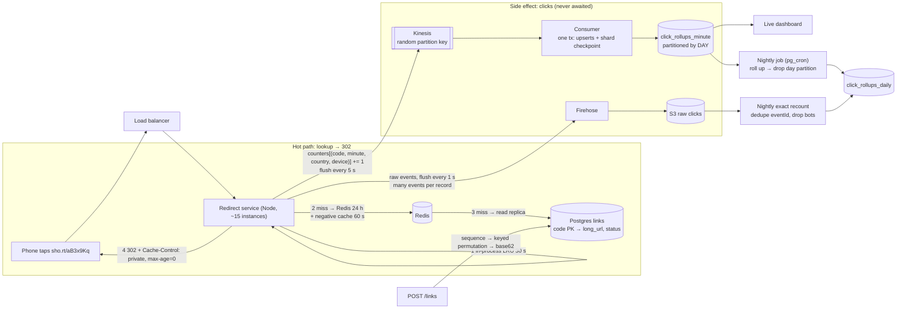

# arch-02. URL shortener for marketing campaigns

*Scaling · Easy*

## The question

"We run a marketing platform. Customers put short links (`sho.rt/aB3x9Kq`) in SMS and email campaigns and want click analytics per link: count, country, device. Expect ~100M new links a month and ~10B redirects a month, with campaign blasts causing sharp spikes. Design the shortener."

**Then:** "A customer's link runs in a TV ad and gets 2M clicks in one minute, and they want clicks by country live on their dashboard. Separately, security reports someone is enumerating codes to find links that were meant to stay private."

Try it first: talk through clarify → design → deep dives out loud, then open the answer.

<details>
<summary>Model answer</summary>

## Architecture diagram



- **Hot path** = lookup → 302, nothing else: in-process cache → Redis (+ negative cache for unknown codes) → read replica.
- **302 + `Cache-Control: private, max-age=0`**: every click reaches us (analytics, edits, takedowns). A 301 or CDN-cached redirect hides repeat clicks.
- **Codes:** Postgres sequence → keyed permutation (unique, non-sequential) → base62, 7 chars ≈ 3.5T codes.
- **Side effect, never awaited:** in-memory counters per (code, minute, country, device), flushed every 5 s; many instances' partial counts add into one row.
- **Kinesis** with a random partition key (a viral link must not land on one shard). The consumer writes upserts + shard checkpoint in **one transaction** → redelivered batches are skipped.
- **Tiers:** minute rows in a table partitioned by **day**, kept ~3 days; nightly job rolls the oldest day into `click_rollups_daily` and drops the partition (instant, unlike DELETE).
- **Exact numbers:** raw events (packed many per record: Firehose bills each record as ≥ 5 KB) → S3 → nightly recount deduped by eventId, bots removed, overwrites daily totals.

## Clarifying questions

- Can destinations be edited, disabled or expired? → assume: yes (customers fix typos, we take down abuse). This decides 301 vs 302.
- Custom aliases (`sho.rt/summer-sale`)? → assume: yes on paid plans, unique, at least 8 characters.
- Redirect latency? → assume: < 10 ms server time p99; the user is on a phone tapping an SMS.
- Analytics freshness and exactness? → assume: dashboard within ~1 minute; exact numbers (for invoices) by the next morning.
- Numbers → assume: writes 100M/month ≈ 40/s avg. Redirects 10B/month ≈ 3.9k/s avg, ~40k/s in blasts. Links ≈ 1.2B/year × ~300 B (code, URL, owner, dates) ≈ 360 GB/year plus indexes. Click events 10B/month × ~150 B ≈ 1.5 TB/month raw.
- Read:write ratio → assume: ~100:1, so the redirect path gets all the optimization.

## Design

**1. Create** `POST /links {url, alias?, expiresAt?}`: validate scheme (http/https), length (≤ 2 KB), check a malware/phishing blocklist, generate a code, insert.

**2. Code generation.** `id = nextval('link_id_seq')` (40/s is nothing for a sequence), then a keyed 40-bit Feistel permutation of the id, then base62, padded to 7 chars. 2^40 ≈ 1.1 trillion values fit in 7 base62 chars (62^7 ≈ 3.5 trillion). The permutation is a bijection, so codes are unique without a collision check, and they don't look sequential.

**3. Data**
```sql
links(code text PRIMARY KEY, customer_id bigint, long_url text,
      status text,            -- active | disabled
      expires_at timestamptz, created_at timestamptz)
click_rollups(code, minute timestamptz, country char(2), device text, clicks bigint,
      PRIMARY KEY (code, minute, country, device))
```
Postgres handles the first few billion rows with a PK lookup; hash-partition by `code`, or move links to DynamoDB, when one instance's storage or vacuum gets painful.

**4. Redirect** `GET /:code`: in-process LRU (100k entries, 30 s TTL) → Redis (cache-aside, 24 h TTL, negative cache for unknown codes 60 s) → Postgres replica. Answer `302` with `Location` and `Cache-Control: private, max-age=0`. Expired/disabled → 404/410 page. A Node instance does several thousand of these per second, so ~10-15 instances cover 40k/s with headroom.

**5. Click events.** The handler builds `{code, ts, country (local MaxMind DB lookup), device (UA parse), referrer}` and pushes it to an in-memory buffer; never awaited on the redirect path. The buffer pre-aggregates per `(code, minute, country, device)` for 5 s and flushes to Kinesis (or Kafka). A consumer upserts `click_rollups` (`clicks = clicks + EXCLUDED.clicks`). Firehose writes raw events to S3; a nightly job recomputes exact counts, filtering bots.

**6. Abuse:** rate limit link creation per account, rescan destinations periodically, disable flag propagates through the 30 s/24 h caches by explicit invalidation (delete Redis key + publish an invalidation message to instances).

**7. Full click pipeline (what each piece does)**
```
redirect server (RAM): 1) cache lookup → 302        ← hot path ends here
                       2) counters[(code, minute, country, device)] += 1   flushed every 5 s
                       3) rawBatch.push({eventId, code, ts, ip, ua})       flushed every 1 s
  counters ──► Kinesis (stream) ──► consumer ──► Postgres click_rollups_minute ──► dashboard
  rawBatch ──► Firehose ──► S3 files ──► nightly exact recount ──► click_rollups_daily (overwrite)
```
- The **minute** is the bucket in the key; **5 s** is only the flush interval. Many flushes and many instances for the same bucket just add into one row (sums commute, so instances never coordinate).
- **Firehose** = delivery pipe that buffers records (~60 s / few MB) and writes files to S3; no consumer code. Pack many events per record: Firehose bills each record rounded up to 5 KB.
- **Idempotent consumer**: Kinesis is at-least-once and `+N` isn't safe to repeat. The consumer writes the batch's upserts **and** `stream_checkpoints(shard_id, last_seq)` in one Postgres transaction; on restart it resumes after `last_seq`, so a redelivered batch is skipped.

**8. Storage tiers**
```sql
click_rollups_minute(code, minute timestamptz CHECK (minute = date_trunc('minute', minute)),
                     country, device, clicks, PRIMARY KEY (code, minute, country, device))
  PARTITION BY RANGE (minute);         -- one child table per DAY, created 7 days ahead
click_rollups_daily(code, day, country, device, clicks, PRIMARY KEY (code, day, country, device))
```
Nightly job (pg_cron / pg_partman): create future day partitions → roll the day older than 3 days into `click_rollups_daily` (`INSERT … SELECT sum … ON CONFLICT DO UPDATE SET clicks = EXCLUDED.clicks`) → `DETACH PARTITION` → `DROP TABLE`. Dropping a day deletes its files instantly; a `DELETE` of 100M rows would bloat the table and the WAL.

## Deep dives

**1. 301 vs 302.** A 301 is permanent: browsers cache it, often with no expiry, so repeat clicks never reach us. We lose analytics, and an edited or disabled link keeps redirecting for those users. Chosen: 302 (or 307) with `Cache-Control: private, max-age=0`. Rejected: 301 to save load. 40k/s from cache is cheap; the analytics are the product.

**2. ID generation.** Options: (a) random 7 chars + insert, retry on unique violation: fine too, collision odds at 1.2B of 3.5T used are ~0.03% per insert; (b) hash of the URL truncated: collisions, and two customers shortening the same URL must get two links for separate analytics; (c) counter + base62: unique but enumerable and it leaks our volume; (d) counter + keyed permutation. Chosen (d), (a) is an acceptable answer. Rejected (b) and plain (c).

**3. The viral link (twist, part 1).** 2M clicks/min ≈ 33k/s on one code. Reads: the in-process LRU absorbs it; Redis sees about one request per instance per 30 s. Events: if the stream is partitioned by `code`, all 33k/s land on one Kinesis shard, which accepts 1,000 records/s or 1 MB/s writes. Chosen: pre-aggregate in the redirect process (one record per code/minute/country/device every 5 s, a 1000x reduction) and partition by a random key. The dashboard reads minute rollups. Rejected: an `UPDATE links SET clicks = clicks + 1` per click (one hot row, lock queue, and a DB outage breaks redirects).

**4. Enumeration (twist, part 2).** Short codes are public by design: at ~1.2B live links in a 1.1T space, random guessing hits one link per ~900 tries. Chosen: rate-limit 404s per IP and ASN, alert on scanners, and offer "unlisted" links with 12+ random base62 chars (~71 bits) for anything sensitive. Rejected: claiming the permutation makes codes secret; it only hides ordering.

**5. How many rollup rows?** One row per (code, minute, country, device) with ≥ 1 click. Bursty links collapse (2M clicks/min → a few hundred rows/min); long-tail links (1 click every few hours) stay ~1 row per click. Realistic order: 1–5B minute rows/month, not millions. Chosen: keep minute rows ~3 days (≈ 300M rows, fine in day-partitioned Postgres), keep daily rows forever. Move rollups to **ClickHouse** if they still outgrow Postgres (aggregation-heavy = columnar). Rejected: Cassandra/Scylla with one row per click: 10B writes/month, a hot partition per viral link, and dashboards counting millions of rows per query.

**6. Live vs exact numbers.** Live rollups can be slightly off: a crash loses ≤ 5 s of in-memory counts from that instance, and bots aren't filtered yet. The nightly recount from raw S3 events (dedupe by `eventId`, drop bots and scanners) overwrites daily totals; invoices use those. Clicks lost in a crash are lost from both paths; accepted for analytics (for orders/payments you would write synchronously instead).

**7. If the product must list every click.** Raw events still never go through the redirect's own DB write: the stream consumer batch-inserts them into **ClickHouse** (best fit: billions of rows, fast filters) or Cassandra/Scylla partitioned by `(code, day)` so one viral link can't make one giant partition; or query the S3 files with Athena when minutes of delay are fine.

## Traps

- Using 301 because "it's faster": cached redirects break analytics and take-downs.
- Writing a DB row per click inside the redirect: adds latency, creates a 40k/s write load, and a DB incident breaks every link in every SMS already sent.
- Truncated MD5/SHA of the URL as the code: collisions after truncation, and one link shared by two customers.
- Counting every hit as a human click: email security scanners and chat apps (Slack, iMessage link previews) fetch links before any person does. Filter by user agent and known scanner IP ranges; mark rather than drop.
- Partitioning the click stream by link code: one viral link becomes one hot shard.
- Forgetting the negative cache: scanners hitting random codes go straight to the database.
- Caching the redirect at the CDN "to be faster": same effect as a 301, repeat clicks never reach you.
- Buffering clicks only in Redis before a periodic sync: a Redis or instance failure loses them; ship to a durable stream after a few seconds in memory.
- Sending one tiny event per Firehose record: billed as 5 KB each (10B events ≈ 50 TB billed instead of 1.5 TB).
- Expiring old minute rows with `DELETE`: bloat and WAL churn; partition by day and drop.

## Say it (60–90 s)

Reads dominate about a hundred to one, so I design for the redirect path. Creating a link takes a sequence value, runs it through a keyed forty-bit permutation and base62-encodes it to seven characters, so codes are unique without a collision check and don't look sequential. Links live in Postgres with the code as primary key. A redirect checks an in-process cache, then Redis, then a read replica, and returns a 302, not a 301, because a 301 gets cached by the browser and we'd lose clicks and the ability to disable a link. Analytics never block the redirect: each instance buffers click events, pre-aggregates per link, minute, country and device for a few seconds, and ships them to Kinesis. A consumer upserts minute rollups that the dashboard reads, and raw events go to S3 for an exact nightly recount that filters bots and email scanners. For the TV ad, the hot link is served from memory, and pre-aggregation plus a random partition key keeps it from overloading one stream shard. Codes are public by design, so against enumeration I rate-limit 404s per IP and offer long random codes for sensitive links.

## Follow-ups

**Q:** How do custom aliases avoid colliding with generated codes?
**A:** Generated codes are exactly 7 chars; aliases must be 8+ chars. Same `code` primary key, so an alias insert that conflicts returns 409 "alias taken".

**Q:** How do you serve redirects from several regions?
**A:** Read replicas (or DynamoDB global tables) per region with latency-based DNS; writes go to one region. A just-created link can miss in another region for ~1 s of replication lag, so a miss falls back to the primary region before returning 404.

**Q:** How fast does an abuse take-down take effect?
**A:** Set `status = disabled`, delete the Redis key and broadcast an invalidation to instances; worst case the 30 s in-process TTL. Without the broadcast it's bounded by the TTLs, which is why they're short in-process.

**Q:** Why Kinesis and not SQS for the click counts?
**A:** After pre-aggregation either works and SQS is cheap at that volume. Kinesis gives per-shard order and sequence numbers, so the checkpoint-in-the-same-transaction trick makes the consumer idempotent; with SQS you'd keep a processed-message-id table instead. Raw events go through Firehose because it writes S3 files with no consumer code.

</details>

## Theory in the notes

- [03-databases/03-schema-migrations-and-scaling.md](../../03-databases/03-schema-migrations-and-scaling.md)
- [03-databases/04-redis-and-caching.md](../../03-databases/04-redis-and-caching.md)
- [03-databases/05-analytical-and-document-databases.md](../../03-databases/05-analytical-and-document-databases.md)
- [06-distributed-systems/01-messaging-queues-kafka-sqs.md](../../06-distributed-systems/01-messaging-queues-kafka-sqs.md)
- [10-system-design/01-system-design-framework.md](../../10-system-design/01-system-design-framework.md)
- [10-system-design/02-worked-examples.md](../../10-system-design/02-worked-examples.md)
- [10-system-design/05-social-and-content.md](../../10-system-design/05-social-and-content.md)
