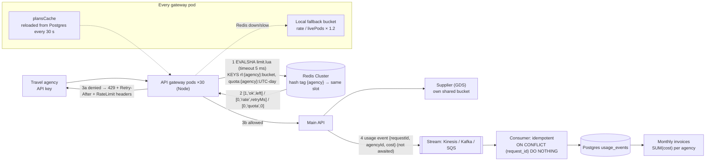

# arch-03. Rate limiter service for an API gateway

*API Design · Easy*

## The question

"We sell flight and hotel search through a public API to ~5,000 travel agencies. All traffic goes through our Node API gateway (30 pods in 2 AZs), ~40k requests/s at peak. Each agency's plan sets limits, e.g. 50 searches/s and 1M per day, and every flight search costs us money upstream. Design the rate limiter the gateway calls on every request."

**Then:** "Redis fails over and for 20 seconds every limiter call errors. Separately, a large agency complains they get 429s while their own metrics say they're at 60% of their per-second limit."

Try it first: talk through clarify → design → deep dives out loud, then open the answer.

<details>
<summary>Model answer</summary>

## Architecture diagram



- **One place decides:** the gateway. Backend services don't count again.
- **plansCache** reloads limits from Postgres every 30 s, so 40k req/s never hit Postgres; plan changes apply within 30 s.
- **1–2 One Lua script, one round trip:** token bucket (hash {tokens, ts}, refilled from elapsed time up to burst, spends cost) + daily `INCRBY` on a UTC-day key; checks both before spending. Hash tag `{agency}` puts both keys in one cluster slot.
- **Why a bucket, not a per-second counter:** same average, but no 2× bursts at window edges and no fleet-wide spikes when every agency's window resets at :00.000.
- **3a 429** with Retry-After (from the script) and RateLimit headers so clients can pace themselves.
- **Redis down:** after a 5 ms timeout, local buckets enforce `rate / livePods × 1.2`: bounded, approximate, never “block all” or “allow all”.
- **4 Billing is not the limiter:** usage events → stream → idempotent consumer → usage table → invoices. Limiter counters are disposable (resets, GETDEL crash loss, async replication).

## Clarifying questions

- What do we limit: requests or cost? → assume: cost units. A hotel availability search = 5 units, a booking lookup = 1. Limits per agency and per API key, plus a global cap per upstream supplier.
- How precise? → assume: per-second limit ±5% is fine (it protects capacity and upstream cost); an agency must never get much more than its burst for more than a second. Daily quota: enforcement may be slightly loose (1,000,500 instead of 1,000,000 is fine), but what we **bill** must be exact.
- Daily = UTC calendar day or rolling 24 h? → assume: UTC calendar day, resets at 00:00 UTC (simple, documented; rolling windows per client are rarely worth it).
- Per-second limits and daily quotas both? → assume: yes. Per-second protects us (Redis); the daily quota is billing (Redis counter + usage events to billing).
- Latency budget? → assume: < 1 ms p99 added, so one in-AZ Redis round trip per request, no extra service hop.
- Fail open or fail closed? → assume: open with a local fallback (deep dive 2).
- Numbers → assume: 40k req/s × 1 Lua script each = 40k scripts/s. One Redis shard does on the order of 100k simple ops/s; scripts cost more, so a 3-shard Redis Cluster with replicas, ~2.5k agencies' keys per shard. Memory is trivial: 5,000 agencies × a few keys × ~100 B.

## Design

**Shape.** "Shared service" = shared rules + shared state, with the decision made in a gateway library. A separate limiter service (the Envoy global rate-limit model) adds a network hop; worth it only with several gateway technologies.

**1. Rules.** `plans(plan_id, rate_units_per_s, burst_units, daily_quota)` plus per-agency overrides and per-endpoint costs, in Postgres. Gateways cache them in memory and refresh every 30 s.

**2. Who does what.** The **gateway** alone decides allow/deny (backend services don't count again; two counters disagree). Billing is a separate pipeline fed by usage events (point 6). Nothing is synced between them.

**3. Gateway (Node, every pod)**
```ts
// startup, once per pod
redis.defineCommand('limit', { numberOfKeys: 2, lua: fs.readFileSync('./limit.lua', 'utf8') });
   // ioredis loads the script into Redis once (SCRIPT LOAD), then calls it by SHA (EVALSHA)
let plansCache = new Map<string, Plan>();          // plan limits from Postgres
await refreshPlans(); setInterval(refreshPlans, 30_000);   // 40k req/s must not hit Postgres; plan changes apply within 30 s
const COST = { '/flights/search': 5, '/hotels/search': 5, '/bookings/:id': 1 };

// per request (middleware)
const agency = await auth(req.headers['x-api-key']);       // API key → agency, cached in memory
const plan = plansCache.get(agency.planId);
const cost = COST[route] ?? 1;
const day = new Date().toISOString().slice(0, 10);         // "2026-10-28" UTC
let r;
try {
  r = await withTimeout(redis.limit(
        `rl:{${agency.id}}:bucket`, `quota:{${agency.id}}:${day}`,
        plan.ratePerSec, plan.burst, cost, plan.dailyQuota, 48 * 3600), 5 /* ms */);
} catch { r = localFallback.check(agency, cost); }        // Redis down/slow: deep dive 2
const [ok, reason, n] = r;                                 // [1,'ok',left] | [0,'rate',retryMs] | [0,'quota',0]
if (!ok) return send429(reason, n);                         // Retry-After + RateLimit headers
next();
```

**4. `limit.lua`: both limits in one atomic step** (tested on Redis 7). One script because both checks must happen together: a request rejected by the daily quota must not spend a token, and no other pod may interleave between read and write. Both keys share the `{agencyId}` hash tag, so they live in one cluster slot, which a single script requires.
```lua
-- KEYS[1] = bucket key, KEYS[2] = daily quota key (same {agency} hash tag → same slot)
-- ARGV[1] = rate (tokens/s), ARGV[2] = burst (bucket size), ARGV[3] = cost,
-- ARGV[4] = daily quota, ARGV[5] = quota key TTL in seconds
local rate, burst, cost = tonumber(ARGV[1]), tonumber(ARGV[2]), tonumber(ARGV[3])
local quota, quotaTtl = tonumber(ARGV[4]), tonumber(ARGV[5])

local t = redis.call('TIME')                         -- {seconds, microseconds}: Redis clock
local now = t[1] * 1000 + math.floor(t[2] / 1000)    -- milliseconds

-- 1. read the bucket (missing → full)
local b = redis.call('HMGET', KEYS[1], 'tokens', 'ts')
local tokens = tonumber(b[1]) or burst
local ts = tonumber(b[2]) or now

-- 2. refill for the time that passed, capped at the bucket size
tokens = math.min(burst, tokens + (now - ts) * rate / 1000)

-- 3. check both limits BEFORE spending anything
local used = tonumber(redis.call('GET', KEYS[2]) or '0')
if tokens < cost then
  redis.call('HSET', KEYS[1], 'tokens', tokens, 'ts', now)
  return {0, 'rate', math.ceil((cost - tokens) * 1000 / rate)}   -- denied + retry-after ms
end
if used + cost > quota then
  return {0, 'quota', 0}
end

-- 4. both OK: spend and write back
tokens = tokens - cost
redis.call('HSET', KEYS[1], 'tokens', tokens, 'ts', now)
redis.call('PEXPIRE', KEYS[1], 60000)                -- idle bucket disappears after 60 s
redis.call('INCRBY', KEYS[2], cost)
redis.call('EXPIRE', KEYS[2], quotaTtl, 'NX')        -- set TTL only once (Redis 7+)
return {1, 'ok', math.floor(tokens)}
```
- **Token bucket** = one Redis hash per agency, two fields: `tokens` (requests it may still make now) and `ts` (when `tokens` was last updated). Tokens grow by `rate` per second of elapsed time up to `burst`; each request spends `cost`. Nothing refills in the background: each call computes the refill since `ts`.
- **Inputs**: `rate` (tokens/s = average allowed rate, from the plan), `burst` (max tokens = most requests at once after a quiet period), `cost` (5 for a search, 1 for a lookup), `quota` (cost units per UTC day), `quotaTtl` (48 h, so yesterday's total is still readable).
- **Commands**: `TIME` (Redis's clock, shared by all pods), `HMGET`/`HSET` (read/write fields of a hash), `GET`/`INCRBY` (read/add to the daily counter), `PEXPIRE` (delete the bucket after 60 s idle: it would be full again, so missing = full), `EXPIRE … NX` (set the quota key's TTL only the first time). Redis returns everything as text and `ARGV` arrives as text, hence `tonumber`; `tonumber(false)` (missing field) is `nil`, hence `or burst`.
- Example (rate 50, burst 3, cost 1): requests at 0, 5, 10 ms → allowed (tokens 2 → 1.25 → 0.5); at 15 ms 0.75 < 1 → 429; at 60 ms refilled to 3 → allowed.

**5. Response:** `429` with `Retry-After` (seconds until a token is back, from the script) and rate-limit headers (IETF draft `RateLimit-Policy` / `RateLimit`, older `X-RateLimit-*`), so clients can pace themselves.

**6. Billing (exact) is not the limiter.** On every billable request (the main API after a search succeeds, or the gateway if every allowed call is billable) emit `{requestId, agencyId, cost, ts}` into an in-memory batch → stream (Kinesis/Kafka/SQS), not awaited → consumer writes `usage_events` idempotently (`ON CONFLICT (request_id) DO NOTHING`, or checkpoint in the same transaction) → invoices from `SUM(cost)` per agency per month. Limiter counters and billing totals may differ slightly (search failed after being allowed; Redis lost increments in a failover); only the billing table is the invoice.

**7. Upstream protection:** a separate bucket per supplier endpoint (e.g. GDS flight search) shared by all agencies, so the sum of individually legal traffic can't exceed what we pay for.

**8. Failure handling:** Redis call timeout 5 ms; a circuit breaker per pod switches to local buckets (deep dive 2).

**9. Metrics:** decisions by agency/result, Redis latency, fallback mode on/off, top agencies by 429s.

## Deep dives

**1. Algorithm.** **Fixed window** = a counter per agency per second: `MULTI` / `INCR rl:42:1730106000` / `EXPIRE … 2` / `EXEC` (`MULTI` so the key can't be left without a TTL), then `count > 50 → 429`. The average over time still holds, but: (a) it allows 2x the limit across a window boundary (50 at 0.99 s, 50 at 1.01 s = 100 in 20 ms, a momentary 5,000/s toward a supplier that limits us per second); (b) every agency's window resets at the same clock instant, so scripted clients all fire at :00.000 of every second and the fleet sees synchronized spikes; (c) "never more than 50 in any second" is broken. Sliding log is exact but stores every timestamp: 50/s × 5,000 agencies is fine, 40k/s of timestamps in sorted sets is waste. Sliding window counter (current + weighted previous window) is a good approximation. Chosen: token bucket. It expresses "average rate + allowed burst" directly, refills continuously per agency (no shared boundary), and supports weighted cost; `burst = rate` makes it behave almost like a per-second limit. Fixed window is an acceptable answer when spikes hurt nobody, if you name the boundary trade-off. Rejected: fixed window (boundary bursts), sliding log (memory and CPU for no gain).

**2. Redis failover (twist, part 1).** Options: fail closed (every request 429 for 20 s: we turned a cache failover into a full API outage), naive fail open (an abusive agency gets unlimited flight searches that cost us money). Chosen: fail open to **local** buckets: each pod enforces `agency_rate / live_pod_count × 1.2`, pod count from the service registry. Errors are approximate for 20 s, but bounded. Expensive supplier calls keep their own local caps. Rejected: no timeout on Redis calls (gateway threads wait, latency explodes).

**3. 429 at "60%" (twist, part 2).** Their metric is usually a per-minute average; the bucket enforces per second. Bursty traffic (a batch job firing 200 requests at once) is at 60% on average and over the burst for that second. Other causes: cost weights (hotel searches cost 5), the per-key limit being lower than the agency limit, retries counted by us but not by them. Chosen: return `RateLimit` headers on every response so they see remaining units, show 1-second usage graphs in their portal, set burst ≈ 2x the per-second rate. Rejected: silently raising limits.

**4. Hot agency.** One agency at 5k req/s is fine for one Redis shard. If a single key ever gets near shard limits, pods take tokens in batches (reserve 20 units, spend locally) at the cost of some precision.

**5. Why not flush the Redis counters into the DB for billing?** Read-then-reset (`GET` → write DB → `SET 0`) loses increments that land in between. `GETDEL` (read and delete in one step) fixes that race, but the count then exists only in the process's memory: a crash before the DB write loses it. And Redis replication is asynchronous: the primary replies "51" first and ships the write to its replica a few ms later; if it dies in between, the promoted replica says 50. Fine for a limiter (a few extra requests allowed), not for money. So the limiter's keys are disposable (a Redis restart just resets buckets) and billing comes from durable events.

**6. Redis Cluster and hash tags.** 40k scripts/s across ~5,000 agencies: a few primaries, each owning a range of the 16,384 slots (a slot is a group of keys, any number of keys per slot; 16,384 only sets how finely keys can be moved between nodes), each with a replica. Slot = `CRC16(key) % 16384`, but only the `{…}` part is hashed if present: `rl:agency42:bucket` → slot 7512, `quota:agency42:2026-10-28` → 4584 (a script touching both fails with `CROSSSLOT`); `rl:{agency42}:bucket` and `quota:{agency42}:2026-10-28` → both 12687. Cost: one agency's keys live on one node.

## Traps

- In-memory limiter per pod only: with 30 pods behind a load balancer, the real limit is 30x the configured one and changes with autoscaling.
- GET-then-SET from Node instead of an atomic script: two pods read the same count and both allow.
- Using pod clocks in the refill math: clock skew between pods gives tokens away or takes them.
- Fixed one-second windows: 2x bursts at the boundary.
- Failing closed on a Redis error: the limiter becomes the biggest outage risk in the gateway.
- Treating the daily quota as billing truth from a Redis counter that can lose writes on failover.
- Counting in both the gateway and the backend services: two numbers that disagree; one place decides.
- `INCR` then `EXPIRE` as two separate calls: a crash in between leaves a key that never expires (use `MULTI`, Lua or `EXPIRE … NX`).
- Billing from the limiter's Redis counters, or "flushing" them to the DB: lost increments on reset races, crashes and async-replication failovers.
- Two limits checked with two round trips (or two scripts): a request rejected by the daily quota has already spent a token; one script checks both, then spends.

## Say it (60–90 s)

I'd put the decision in a gateway library and the state in Redis, so there's no extra network hop. Rules, plans and endpoint costs live in Postgres and are cached in each pod. Each request runs one Lua script against a token bucket keyed by agency, which refills by elapsed time using Redis's own clock and deducts the endpoint's cost atomically, so two pods can't both spend the last token. I use a token bucket because it states rate plus burst directly; a fixed window lets twice the limit through at window edges. Agency and API-key buckets share a hash tag so one script checks both in Redis Cluster. A rejected call gets 429 with Retry-After and rate-limit headers. A separate bucket per upstream supplier protects what we pay for. If Redis fails over, calls time out after a few milliseconds and a circuit breaker switches each pod to a local bucket with its share of the agency limit, so we neither block everyone nor go unlimited. For the agency at sixty percent, their average hides one-second bursts above the bucket; the headers and per-second usage graphs show them that.

## Follow-ups

**Q:** Why not use API Gateway / WAF rate limiting instead?
**A:** AWS API Gateway usage plans do throttling and quotas per API key, and WAF rate rules work per IP or header over a window. Neither supports weighted costs or per-supplier caps. Fine for a simple API; we need custom logic.

**Q:** Limits across two regions?
**A:** Usually split the limit per region (e.g. by where the agency's traffic actually goes) and sync usage asynchronously. A global synchronous counter adds cross-region latency to every request.

**Q:** How do you test it?
**A:** Unit-test the Lua script against a real Redis in a container, with an optional `now` argument the script uses instead of `TIME` in tests only; load-test with many pods against one agency to verify the total allowed rate; chaos test by killing the Redis primary and checking the fallback rate.

**Q:** Isn't a per-second counter good enough? The average is the same.
**A:** Often yes. The difference is peaks: 2x bursts at each window edge, and every agency's window resets at the same instant, so the fleet and the supplier see synchronized spikes. Token bucket smooths it; fixed window is fine if spikes cost nothing.

</details>

## Theory in the notes

- [03-databases/04-redis-and-caching.md](../../03-databases/04-redis-and-caching.md)
- [04-api-design/03-idempotency-pagination-rate-limiting-webhooks.md](../../04-api-design/03-idempotency-pagination-rate-limiting-webhooks.md)
- [06-distributed-systems/03-resilience-patterns.md](../../06-distributed-systems/03-resilience-patterns.md)
- [10-system-design/09-data-and-infrastructure.md](../../10-system-design/09-data-and-infrastructure.md)
