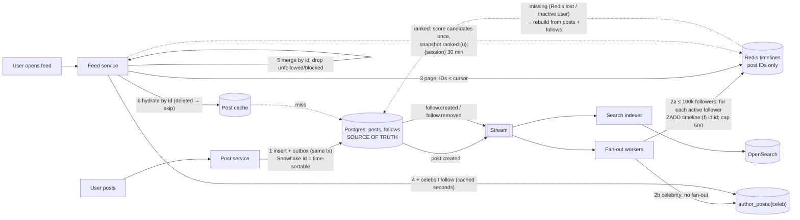

# arch-04. News feed for a social app

*Social · Medium*

## The question

"Design the home feed for a social app: 50M daily active users, each follows ~200 accounts on average, opens the feed ~10 times a day. Users post ~5M times a day. The feed should load in under 300 ms and show new posts from followed accounts within a minute."

**Then:** "A celebrity with 30M followers posts. Also, product now wants a ranked feed instead of chronological, and users complain they see the same post twice when they scroll."

Try it first: talk through clarify → design → deep dives out loud, then open the answer.

Model answer

## Architecture diagram

- **Source of truth:** posts + follows in Postgres. Everything in Redis is derived and rebuildable.
- **2a Fan-out on write:** a post's ID is added to each active follower's timeline (IDs only, capped at 500). Reads become one Redis call.
- **2b Celebrities** (> ~100k followers): no fan-out; their IDs live in `author_posts`, merged at read time (hybrid).
- **3 Cursor pagination:** “IDs older than the last one shown”; time-sortable (Snowflake) IDs make it a number comparison, so new posts don't cause duplicates. A sorted set answers it in one command.
- **5–6 Merge + hydrate:** ~1,000 IDs merged in memory; posts loaded by ID (edits show automatically, deleted posts skipped).
- **Ranked feed:** score the candidates once per session and page through a saved snapshot (30 min TTL).
- **Follow/unfollow** are events too: backfill on follow, cleanup + read-time filter on unfollow. **Search** is a separate read model (OpenSearch).

## Clarifying questions

- Chronological or ranked? → assume: chronological first (the twist changes it).
- Follower distribution? → assume: heavy tail. Median ~150 followers; ~10k accounts have > 100k; a few have tens of millions.
- What does a feed item contain? → assume: post IDs only in the feed store; post bodies, media URLs and counts are hydrated from a post cache.
- How far back can a user scroll? → assume: ~500 items in the precomputed feed; older pages are built on demand.
- Numbers → assume: feed reads 50M × 10 = 500M/day ≈ 6k/s avg, ~20k/s peak. Posts 5M/day ≈ 60/s. Fan-out on write: 5M × ~200 = 1B feed inserts/day ≈ 12k/s avg, much higher in bursts.
- Feed storage → assume: Redis list of 8-byte post IDs per user, capped at 500, only for users active in the last 7 days (~30M). Listpack-encoded integers take ~10-12 B each, so ~6 KB/user ≈ 180 GB across a Redis Cluster, plus replicas.

## Design

**1. Post write.** `POST /posts` → Postgres `posts(id bigint, author_id, body, media, created_at)` where `id` is a Snowflake-style 64-bit ID (ms timestamp + worker + sequence), so IDs sort by time. Outbox → SNS/Kafka `post.created`.

**2. Fan-out workers** (consumers of `post.created`):
- Author has ≤ 100k followers: page through `follows(followee_id, follower_id)` in batches of 1,000, skip followers inactive > 7 days, and for each `LPUSH feed:{user} id` + `LTRIM feed:{user} 0 499`, pipelined.
- Author has > 100k followers: no fan-out. The post goes only into `author_posts:{author}` (their recent 100 IDs).

**3. Feed read** `GET /feed?cursor=<postId>&limit=20`:
1. `LRANGE feed:{me}` from the cursor position (or the IDs older than the cursor).
2. Merge with recent IDs from the celebrities I follow (I follow ~10 of them on average; read their `author_posts` lists, cached in memory on the feed service).
3. Merge by ID (time order), drop blocked/deleted, take 20.
4. Hydrate: multi-get from the post cache (Redis/Memcached, `post:{id}`), counts from a counters cache.
5. Return `nextCursor = last post ID`.

**4. Cold users.** No feed key (inactive > 7 days) → build on login from followees' recent posts (pull), store it, then fan-out resumes.

**5. Deletes / unfollows.** Don't scrub millions of lists; filter at read time (deleted-post set, block list) and let entries age out.

**6. Storage of follows:** Postgres, `PRIMARY KEY (followee_id, follower_id)` plus an index on `(follower_id)`, sharded by user ID when it outgrows one instance.

## Deep dives

**1. Fan-out on write vs read (celebrity twist).** Write fan-out makes reads one Redis call, but a 30M-follower post becomes 30M list pushes (minutes of work, and a burst that delays every other post). Read fan-out makes writes free but each feed read merges ~200 followees' lists. Chosen: hybrid. Push for normal accounts, pull for accounts above ~100k followers, merged at read time. The celebrity's post appears for followers as soon as their next read merges `author_posts`. Rejected: pure push (celebrity bursts), pure pull (20k reads/s × 200 lookups = 4M Redis ops/s).

**2. Pagination (duplicate posts twist).** Offset pagination (`page=2`) on a list that receives new items at the head shifts everything down, so page 2 repeats the end of page 1. Chosen: cursor = last seen post ID; the next page is "IDs older than the cursor". Snowflake IDs make that a numeric comparison. Rejected: offset/limit.

**3. Ranked feed (twist).** Ranking scores change between requests, so ID cursors no longer define a stable order. Chosen: two stages. Candidate generation = the same merged list (last ~500 items); a ranking service scores them (affinity with author, engagement velocity, recency, content type) on the first page; the ranked ID list is stored per session `ranked:{user}:{session}` with a 30-minute TTL; later pages read positions from that snapshot. New posts appear on pull-to-refresh, which starts a new session. Rejected: re-ranking on every page (duplicates and skipped items).

**4. Bursty fan-out.** One post with 100k followers = 100 batches; run batches in parallel through the queue, and give fan-out a separate worker pool so a backlog doesn't delay post creation. SLO: 99% of fan-outs done in 60 s; alert on queue age.

**5. "Will it survive a real app?" (Redis failure, deletes, edits, search).** Timelines are **derived data**; posts and follows in the database are the source of truth. Redis node lost → only the users on that node lose their cached timeline; the next read rebuilds it by fan-out on read (followees' recent posts from the posts store, indexed by `(author_id, created_at)`), slower once, nothing lost. Deletes: remove from the posts store and filter at hydration (a deleted ID hydrates to nothing). Edits: nothing to do, timelines hold IDs and hydration loads the current version. Search is a separate system (OpenSearch fed by `post.created`/`post.deleted` events), not the feed's job. This is broadly how Twitter's timeline service was publicly described: Redis timelines of IDs, hybrid fan-out, rebuild from the source on a miss.

## Traps

- Storing full post bodies in every follower's feed: edits and deletes become millions of writes, and memory grows 50x.
- Pure fan-out on write: a celebrity post becomes tens of millions of writes and delays everyone else's posts.
- Offset pagination on a feed that changes at the head.
- Fanning out to every follower including users who haven't opened the app in a year: most of the write cost for nobody.
- Treating the feed cache as the source of truth: it's derived; it must be rebuildable from posts + follows.
- Ranking with a cursor that assumes a stable order.
- Treating the Redis timelines as the source of truth: they must be rebuildable from posts + follows.
- Paging a list by offset while new items arrive at the head (duplicates); page by "IDs older than the cursor" (a sorted set scored by the time-sortable ID makes that one command).

## Say it (60–90 s)

Reads are about a hundred times writes, so I precompute feeds. Posts go into Postgres with time-sortable Snowflake IDs, and an event goes out through the outbox. Fan-out workers push the post ID into a Redis list per follower, capped at five hundred, but only for followers active in the last week; inactive users get their feed rebuilt when they come back. That's about a billion list inserts a day, and roughly a hundred and eighty gigabytes of Redis if I store only IDs. Accounts above about a hundred thousand followers are not fanned out: their posts go into a per-author list, and at read time I merge the few celebrities a user follows into their precomputed list. Then I filter deleted and blocked posts and hydrate the twenty IDs from a post cache. Pagination uses the last seen ID as the cursor, never an offset, because new posts at the head would shift pages and cause duplicates. For a ranked feed, I score the candidate list on the first page and store that ranked order per session, so later pages are stable; refresh starts a new session.

## Follow-ups

**Q:** How do you show like/comment counts at this scale?
**A:** Counters in Redis (`INCR` per post) flushed to Postgres in batches; displayed counts may lag a few seconds. Hot posts get their counter sharded across N keys and summed on read.

**Q:** A user follows 5,000 accounts?
**A:** Fan-out handles it (they receive more pushes); the cap of 500 entries keeps memory bounded. Pull-based rebuild for them reads only the most recent posts per followee, with a time bound.

**Q:** What if Redis loses a shard?
**A:** Affected users' feeds are rebuilt on their next read from Postgres (followees' recent posts), with a rate limit on rebuilds so a lost shard doesn't stampede the database.

## Theory in the notes

- [10-system-design/05-social-and-content.md](../../10-system-design/05-social-and-content.md)
- [10-system-design/01-system-design-framework.md](../../10-system-design/01-system-design-framework.md)
- [03-databases/04-redis-and-caching.md](../../03-databases/04-redis-and-caching.md)
- [04-api-design/03-idempotency-pagination-rate-limiting-webhooks.md](../../04-api-design/03-idempotency-pagination-rate-limiting-webhooks.md)
