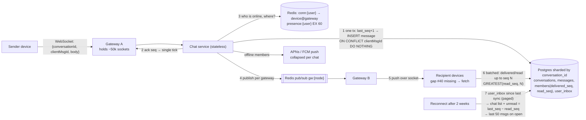

# arch-05. Chat app: groups, receipts, presence, offline

*Realtime · Hard*

## The question

"Design the messaging backend for a consumer chat app: 1:1 chats and groups up to 500 members, delivered/read receipts, online presence, and delivery to users who were offline. 10M daily active users send ~30 messages each per day. Messages must appear in the same order for everyone in a conversation and must never be lost once the sender sees a single tick."

**Then:** "A user has a phone and a laptop, and the phone was offline for two weeks with 300 conversations having new messages. What happens when it reconnects?"

Try it first: talk through clarify → design → deep dives out loud, then open the answer.

<details>
<summary>Model answer</summary>

## Architecture diagram



- **Gateways** hold WebSocket connections (stateful, ~50k per Node process); the chat service is stateless.
- **1 Order + durability:** per-conversation `seq` from a counter row, incremented in the same transaction as the insert. Same order for everyone, and gaps are detectable (#40 missing → fetch).
- **2 Single tick only after commit.** Store first, then ack, then deliver. `clientMsgId` makes retries idempotent.
- **3–5 Delivery:** Redis registry says which gateway holds each member's devices; publish once per gateway on Redis pub/sub; the gateway writes to the sockets. Offline → APNs/FCM push.
- **6 Receipts as watermarks:** per (conversation, member) `delivered_seq`/`read_seq`, batched, `GREATEST(…)`; “read” = read_seq ≥ seq. No row per message per reader.
- **Presence:** heartbeat → `SET presence:{user} EX 60`; expires on its own.
- **7 Reconnect after 2 weeks:** each device syncs by cursor: paged inbox of changed chats → unread counts from watermarks → messages loaded lazily on open. Nothing is replayed over the socket.

## Clarifying questions

- End-to-end encryption? → assume: not in scope; the server can read messages (search, moderation). With E2E the server stores ciphertext and multi-device needs per-device keys.
- Ordering guarantee? → assume: one order per conversation, decided by the server and identical for every member. Not global order.
- Media? → assume: uploaded to S3 via presigned URL; messages carry the object key.
- Retention? → assume: forever, user can delete messages.
- Numbers → assume: 300M messages/day ≈ 3.5k/s avg, ~10k/s peak. ~300 B per stored message → ~90 GB/day ≈ 33 TB/year before replication. Peak concurrent connections ~3M WebSockets; planning ~50k connections per Node gateway process → ~60 gateway processes plus headroom.
- Group delivery cost → assume: average group size 20; a 500-member group message is 500 deliveries, so peak deliveries are several times the send rate.

## Design

**Components:** WebSocket gateways (stateful, hold connections), chat service (stateless), Postgres sharded by `conversation_id` (e.g. 8 shards), Redis (connection registry, presence), push service (APNs/FCM).

**1. Data**
```sql
conversations(id, kind, last_seq bigint, created_at)              -- one row per chat
members(conversation_id, user_id, delivered_seq bigint, read_seq bigint, joined_seq bigint,
        PRIMARY KEY (conversation_id, user_id))
messages(conversation_id, seq bigint, sender_id, client_msg_id uuid, body, created_at,
         PRIMARY KEY (conversation_id, seq), UNIQUE (conversation_id, client_msg_id))
user_inbox(user_id, conversation_id, last_seq, updated_at)          -- on the user's shard
```

**2. Send.** Client sends `{conversationId, clientMsgId, body}` over the socket. Chat service, on the conversation's shard, one transaction:
```sql
UPDATE conversations SET last_seq = last_seq + 1 WHERE id = $1 RETURNING last_seq;
INSERT INTO messages (...) VALUES (..., $seq, ...)
  ON CONFLICT (conversation_id, client_msg_id) DO NOTHING;     -- retry of the same send
```
Commit → ack to sender with `seq` (single tick = durably stored). A retry with the same `clientMsgId` returns the existing seq.

**3. Deliver.** Look up members' connections in Redis (`conn:{userId}` → set of `deviceId@gatewayNode`), group by gateway node, publish one message per node on `gw:{nodeId}` (Redis pub/sub); gateways push to sockets. Members with no live connection → push notification (collapsed per conversation) and a `user_inbox` update.

**4. Receipts as watermarks.** Devices ack "delivered up to seq N" and "read up to seq N" for a conversation, batched every few seconds: `UPDATE members SET delivered_seq = GREATEST(delivered_seq, $n)`. A message is delivered to a member when `delivered_seq ≥ seq`. Groups show "read by 12 of 40".

**5. Presence.** Heartbeat every 30 s; `SET presence:{user} online EX 60`. Presence changes are pushed only to users who have that 1:1 chat open (they subscribe on open). No live presence in groups over ~50.

**6. Sync on reconnect.** Client sends its per-conversation `last_seq` cursors; server answers from `user_inbox` (conversations updated since), then the client fetches messages per opened conversation by `seq > cursor`.

## Deep dives

**1. Ordering and gap detection.** Client timestamps are wrong and skewed. Server timestamps or Snowflake IDs give one order, but a message with an earlier ID can commit after a client already fetched past it, and the client never sees it. Chosen: a gapless per-conversation `seq` from a counter row, incremented in the same transaction as the insert. A client that receives seq 41 after 39 knows 40 is missing and fetches it. Cost: messages in one conversation serialize on that row, ~1k/s per conversation, far above human typing. Rejected: global ordering (one sequencer for everything), timestamp ordering (no gap detection).

**2. Storage choice, and what "8 shards" means.** A shard = a separate Postgres primary (+ its replicas). All rows of a conversation live on one shard, picked by `hash(conversation_id)`, so seq + insert stay one local transaction; `user_inbox` is sharded by `user_id`. Map ~256 logical shards onto 8 physical ones, so later you move logical shards instead of rehashing. Throughput alone does not force 8: one well-tuned primary takes 10k inserts/s with batching or group commit. **Storage forces it**: ~90 GB/day, ~33 TB/year; one instance gets painful at a few TB (vacuum, index size, backup/restore time). 10k/s ÷ 8 ≈ 1.25k/s per shard leaves headroom for inbox and watermark writes. Say: "start with one primary partitioned by time, keep a hot window, archive old partitions to S3; shard by conversation_id when storage or writes need it." Rejected for now: Cassandra/ScyllaDB (what Discord runs at trillions of messages) because seq allocation there needs lightweight transactions or a separate sequencer. Trigger to move: tens of thousands of writes/s or storage beyond what we want to run in Postgres; then message bodies go to the wide-column store keyed by `(conversation_id, bucket)` and seq comes from a single owner per conversation. Costs: [03-databases/06](../../03-databases/06-database-throughput-and-costs.md).

**3. Two weeks offline + multi-device (twist).** Every device is a separate recipient with its own cursors; the sender's other devices receive the sender's messages the same way. On reconnect: (a) fetch `user_inbox` changes since the device's last sync, newest first, paginated (300 rows); (b) render the conversation list with unread = `last_seq − read_seq`; (c) fetch message bodies lazily, last 50 per conversation on open, older on scroll. The client then sends one batched delivered-watermark per conversation, not 10,000 acks. Rejected: replaying every missed message over the socket at connect (minutes of data, battery, and a reconnect storm after an outage).

**4. Gateway failure.** A gateway dies → 50k clients reconnect with exponential backoff + jitter to other nodes; Redis entries for the dead node expire (TTL refreshed by heartbeat). Nothing is lost because delivery to devices is "push what you can, sync fills the rest".

**5. Gateways, pub/sub and fleet size.** Gateway = Node process with `ws` (or uWebSockets.js), behind NLB/ALB that terminates TLS. On connect: verify JWT, keep `Map<userId, Set<socket>>`, `HSET conn:{user} {deviceId} {gatewayId}` with TTL refreshed by heartbeat. At startup `SUBSCRIBE gw:{gatewayId}` once (a subscribing connection can't run other commands, so a second Redis connection for normal ones). Inbound frame → chat service over HTTP/gRPC; it returns the ack; the gateway never touches the DB. Outbound: pub/sub message `{userIds, payload}` → local map → `socket.send`. Redis only brings bytes to the gateway process; **the gateway writes to the socket**. Ping/pong ~25 s (below the ALB 60 s idle timeout); dead socket → close + `HDEL`; `bufferedAmount` over a limit → close the slow client, it syncs on reconnect. No business logic in the gateway, so it rarely deploys.
Redis pub/sub: `PUBLISH` pushes to whoever is subscribed right now, then forgets: no storage, no ack, no replay. A gateway that was disconnected misses it; fine, because the message is already in Postgres and the client catches it by seq gap or sync. In Redis Cluster classic `PUBLISH` goes to every node; Redis 7 `SPUBLISH` goes only to the channel's shard. Channel per gateway = one publish per gateway per message; alternative: channel per user (no registry lookup, ~50k subscriptions per gateway).
Fleet: 10M DAU → ~1–3M concurrent sockets. 50k idle sockets per process is realistic: ~20–50 KB each (~1–2.5 GB), raise `nofile` far above 50k (some containers default to 1,024), heartbeats ~1.7k/s. Fan-out CPU is the real limit: serialize the payload once, not per socket. Docker adds no limit. Many teams keep 10–30k per pod for margin → 60–100+ pods. Kubernetes scales that easily, but unlike stateless pods: scale-up doesn't rebalance existing sockets (autoscale on connection count, not CPU); scale-down or deploy drops ~50k sockets → reconnect storm on the sync endpoint → drain (stop accepting, tell clients to reconnect over random 1–5 min, long grace period, jittered backoff).

## Traps

- Ordering by client timestamps, or by server timestamps without a way to detect gaps.
- A receipt row per message per recipient: a 500-member group creates 500 rows per message. Watermarks per member per conversation are enough.
- Storing a copy of each group message per recipient (fan-out on write to inboxes) instead of once per conversation plus per-member cursors.
- Broadcasting every presence change to all contacts: presence traffic exceeds message traffic. Subscribe only where it's on screen.
- Acking the sender before the message is durably written: "single tick" must mean stored.
- No client message ID: a resend after a timeout creates a duplicate message.

## Say it (60–90 s)

Clients hold a WebSocket to a gateway; the chat service behind it is stateless, and messages live in Postgres sharded by conversation. Sending is one transaction on the conversation's shard: increment the conversation's sequence counter and insert the message with that sequence, with a unique client message ID so a retry returns the same message. Only after commit does the sender get the single tick. The per-conversation sequence gives everyone the same order and makes gaps visible, which timestamps can't. To deliver, I look up each member's connections in Redis, group them by gateway node, and publish once per node; offline members get a push notification. Receipts are watermarks: each member has delivered-up-to and read-up-to sequence numbers, updated in batches, so a five-hundred-person group doesn't create five hundred receipt rows per message. Presence is a Redis key with a sixty-second expiry refreshed by heartbeats, pushed only to people who have that chat open. For the phone that was offline two weeks, it sends its cursors, gets the list of changed conversations with unread counts, and loads messages lazily per conversation.

## Follow-ups

**Q:** How does a new group member avoid seeing old history?
**A:** `members.joined_seq` stores the conversation seq at join; reads return only `seq > joined_seq` for that member.

**Q:** Message edit and delete?
**A:** Stored as new events in the conversation (`seq` N+1 with type `edit`/`delete` referencing the target), so devices that synced earlier learn about it through the same cursor.

**Q:** How do you deploy gateways without dropping 3M connections at once?
**A:** Drain node by node: stop sending new connections to it, then close sockets in small batches with a "reconnect" frame; clients reconnect with jitter. Long `terminationGracePeriodSeconds` on those pods.

**Q:** What are APNs and FCM, and can push replace the socket?
**A:** APNs (Apple) and FCM (Google; Android, web) are the only way to reach an app that isn't connected (iOS kills background sockets). The app gets a device token from the OS → backend stores it in `devices` → a push worker reading a queue POSTs `{token, payload ≤ 4 KB}` over HTTP/2 (APNs: JWT from a .p8 key; FCM: service-account OAuth) → Apple/Google deliver over their own connection. Best effort: delayed, collapsed, dropped. So push only notifies; the app opens and syncs from our server. 410 / UNREGISTERED → delete the token.

**Q:** Why not order by the message's `created_at`?
**A:** Clocks of chat servers differ by ms, same-ms ties, and a transaction that took longer commits after a message with a later timestamp, so a client that fetched "after T" never sees it. No gap detection either. `seq` comes from the locked counter row: commit order = seq order, no gaps. Keep `created_at` for display only.

**Q:** Where are read receipts stored?
**A:** As watermarks in `members` on the conversation's shard: `delivered_seq`, `read_seq` per (conversation, user), updated in batches with `GREATEST` (two devices can send out of order; never move back). Unread = `last_seq − read_seq`; "read by" = members with `read_seq ≥ seq`.

</details>

## Theory in the notes

- [10-system-design/06-realtime-and-collaboration.md](../../10-system-design/06-realtime-and-collaboration.md)
- [03-databases/02-transactions-isolation-locking.md](../../03-databases/02-transactions-isolation-locking.md)
- [03-databases/03-schema-migrations-and-scaling.md](../../03-databases/03-schema-migrations-and-scaling.md)
- [03-databases/04-redis-and-caching.md](../../03-databases/04-redis-and-caching.md)
